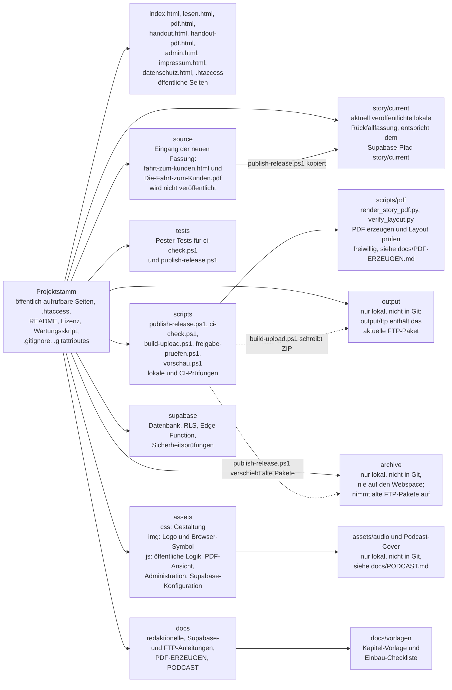

# Repo-Struktur und Release-Ablauf

Diese Seite soll neuen Mitwirkenden und neuen Sitzungen in fünf Minuten zeigen, wo was liegt und wie eine neue Fassung von „Die Fahrt zum Kunden“ live geht. Jede Aussage in den Diagrammen ist in der Belegtabelle darunter mit Datei und Abschnitt belegt.

Stand: `main` 1281bbe vom 08.11.2026. Belege nennen Abschnittsüberschriften (`›`) oder einen wörtlichen Suchbegriff in Anführungszeichen, keine Zeilennummern. So bleiben sie gültig, wenn sich Zeilen verschieben; der Suchbegriff lässt sich mit `git grep -n "<Begriff>" -- <Datei>` auffinden.

Kennzeichnung **offen**: noch nicht im Repository geregelt oder nicht belegbar.

## 1. Verzeichnis- und Dateikarte



## 2. Release-Ablauf von der Quelle bis zur Live-Seite

Verantwortliche: **Bernd/Owner** (Handarbeit), **Skript** (lokal von Bernd gestartet), **CI** (GitHub Actions, Job „Website prüfen“ im Workflow „Website CI“).

```mermaid
flowchart TD
    A["Bernd/Owner<br/>Neue Fassung als<br/>source/fahrt-zum-kunden.html ablegen"]
    B["Bernd/Owner<br/>PDF mit scripts/pdf/render_story_pdf.py<br/>erzeugen und als<br/>source/Die-Fahrt-zum-Kunden.pdf ablegen<br/>siehe docs/PDF-ERZEUGEN.md"]
    Q["Bernd/Owner<br/>Podcast-Dateien lokal unter<br/>assets/audio und assets/img ablegen<br/>siehe docs/PODCAST.md"]
    C["Bernd/Owner startet<br/>scripts/publish-release.ps1"]
    D["Skript<br/>prüft Version, Datum, Historie, PDF-Kennung,<br/>liest Seitenzahl mit pdfinfo,<br/>prüft PDF-Version mit pdftotext"]
    E["Skript<br/>kopiert source nach story/current,<br/>setzt Rückfallwerte in app.js,<br/>lesen.html und index.html"]
    F["Skript<br/>ruft ci-check.ps1 auf"]
    G["Skript<br/>verschiebt alte Pakete nach archive,<br/>build-upload.ps1 prüft erneut und baut<br/>ZIP mit Manifest in output/ftp"]
    H["Skript<br/>gibt Übergabe an den Admin-Bereich aus:<br/>Version, Datum, Seitenzahl, Dateien,<br/>Handout geändert, FTP-Upload nötig"]
    I["Bernd/Owner<br/>Branch und Pull Request auf main"]
    J["CI<br/>Website prüfen: ci-check.ps1,<br/>JavaScript-Syntax, Git-Historie,<br/>Whitespace"]
    T["Skript und Bernd/Owner<br/>Freigabe G1 bis G8: freigabe-pruefen.ps1,<br/>vorschau.ps1, Sichtungsliste,<br/>G8 nur durch Bernd<br/>siehe docs/FREIGABE.md"]
    K["Bernd/Owner<br/>merged nach grüner CI<br/>und erteilter Freigabe G8"]
    L["Bernd/Owner<br/>admin.html: Anmeldung mit MFA,<br/>Version, Datum, Seitenzahl eintragen,<br/>HTML und PDF wählen, Handout nur bei Änderung<br/>STANDARDWEG"]
    M["Supabase<br/>ersetzt Dateien unter stabilen Adressen<br/>und aktualisiert Versionsangaben"]
    N{"Geändert: Dateien, die nicht über<br/>den Admin-Bereich gehen?<br/>index.html, assets/js, assets/css,<br/>Rechtsseiten, weitere Seiten"}
    O["Bernd/Owner<br/>FTP-Upload des Pakets aus output/ftp<br/>von Hand nach DomainFactory"]
    P["Bernd/Owner<br/>Live-Prüfung der öffentlichen<br/>Landingpage im privaten Browserfenster"]
    R{"Erzähltext geändert?"}
    S["Bernd/Owner<br/>Podcast mit Google NotebookLM<br/>neu erzeugen"]
    Z(["fertig"])

    A --> B --> Q --> C --> D --> E --> F --> G --> H --> I --> J --> T --> K --> L --> M --> N
    N -- "ja" --> O --> P
    N -- "nein" --> P
    P --> R
    R -- "ja" --> S --> Z
    R -- "nein" --> Z

    classDef owner fill:#e8f0fe,stroke:#3367d6,color:#000
    classDef skript fill:#e6f4ea,stroke:#188038,color:#000
    classDef ci fill:#fef7e0,stroke:#b06000,color:#000
    class A,B,Q,C,I,T,K,L,O,P,S owner
    class D,E,F,G,H skript
    class J ci
```



Legende: blau Bernd/Owner, grün Skript, gelb CI. Supabase (M) ist kein Verantwortlicher, sondern das Zielsystem des Admin-Bereichs.

Reihenfolge: Erst Pull Request und Merge, dann Upload über den Admin-Bereich (`docs/NEUE-GESCHICHTE.md`, Schritte 4 und 5).

## Ordner-Hash für Archivpakete (scripts/ordner-hash.ps1, Auftrag R55)

Vor dem Löschen eines Pakets aus `archive/ftp-packages` wird geprüft, ob es noch genau dem inventarisierten Stand entspricht. Dafür berechnet `scripts/ordner-hash.ps1` den Ordner-Hash nach der Methode aus R45/R48. Das Skript liest nur; es schreibt, verschiebt und löscht nichts.

```powershell
./scripts/ordner-hash.ps1 -Pfad "archive/ftp-packages/<Zeitstempel>" -Erwartet <Hash aus dem Inventurbericht>
```

- Methode: alle Dateien (auch versteckte), Zeile `<SHA-256 groß>  <relativer Pfad mit \>`, Zeilen mit LF verbunden ohne Schluss-LF, UTF-8 ohne BOM, davon SHA-256.
- Sortierung: **kulturabhängig**, `Sort-Object FullName -Culture de-DE` (ohne Groß-/Kleinschreibung), wie bei der Inventur R45. Ordinal sortiert steht z. B. `UPLOAD-MANIFEST.txt` vor `admin.html`, und der Hash weicht ab (Fehlstart R48). `-Sortierung Ordinal` gibt es nur zum Vergleich.
- Cloud-Platzhalter: Vor dem ersten Lesen prüft das Skript nur die Attribute (Offline, RecallOnOpen, RecallOnDataAccess; Maske wie R45). Bei einem Treffer listet es die Einträge und bricht ohne Hash ab. Es wird nichts hydriert.
- Exit-Code: 0 Hash berechnet (und gleich `-Erwartet`), 1 Abweichung von `-Erwartet`, 2 Abbruch ohne Hash (Ordner fehlt, leer, Platzhalter). `-Zeilen` gibt die gehashten Zeilen zum Vergleich aus.
- Tests: `tests/ordner-hash.Tests.ps1` (kleiner Testordner im TestDrive).

## Belegtabelle

### Verzeichniskarte

| Aussage | Quelle (Datei › Abschnitt oder „Suchbegriff“) |
|---|---|
| Projektstamm enthält die öffentlich aufrufbaren Seiten, README, Lizenz und Wartungsskript | README.md › Projektstruktur |
| Liste der öffentlichen Seiten im Projektstamm | scripts/build-upload.ps1 „$publicFiles“; scripts/ci-check.ps1 „Diese Dateien bilden die minimale veröffentlichungsfähige Website“ |
| `source` enthält die ursprünglichen Quelldateien, die nicht veröffentlicht werden | README.md › Projektstruktur |
| Dateinamen in `source` sind fest vorgegeben | README.md › Empfohlener lokaler Ablauf, Punkte 1 und 2; scripts/publish-release.ps1 „$sourceHtml“, „$sourcePdf“ |
| `story/current` ist die lokale Rückfallfassung und entspricht dem Supabase-Pfad | README.md › Projektstruktur |
| `publish-release.ps1` kopiert `source` nach `story/current` | scripts/publish-release.ps1 „Erst nach allen Eingangsprüfungen“ |
| `scripts` enthält lokale und CI-Prüfungen, `scripts/pdf` die PDF-Werkzeuge | README.md › Projektstruktur; docs/PDF-ERZEUGEN.md (Einleitung) |
| `scripts` enthält auch Freigabeprüfung und lokale Vorschau | README.md › Projektstruktur; docs/FREIGABE.md › Ablauf |
| `tests` enthält die Pester-Tests | README.md › Empfohlener lokaler Ablauf „Invoke-Pester -Path tests“ |
| Inhalt von `assets` (css, audio, img, js) | README.md › Projektstruktur |
| Podcast-MP3 und Cover liegen nicht in Git | .gitignore „Podcast-Dateien“; docs/PODCAST.md |
| `docs` enthält redaktionelle, Supabase- und FTP-Anleitungen, `docs/vorlagen` Vorlage und Checkliste | README.md › Projektstruktur; docs/NEUE-GESCHICHTE.md › 1. Schreiben |
| `supabase` enthält Datenbank, RLS, Edge Function und Sicherheitsprüfungen | README.md › Projektstruktur |
| `archive` nur lokal, nicht in Git, nie auf den Webspace | README.md › Projektstruktur (Absatz nach der Liste); .gitignore „archive/*“ |
| Alte FTP-Pakete werden nach `archive/ftp-packages` verschoben | scripts/publish-release.ps1 „Alte FTP-Pakete bleiben wiederherstellbar“ |
| `output` ist nicht in Git | .gitignore „output/“ |
| `build-upload.ps1` schreibt das ZIP nach `output/ftp` | scripts/build-upload.ps1 „$outputRoot“, „Compress-Archive“ |

### Release-Ablauf

| Aussage | Quelle (Datei › Abschnitt oder „Suchbegriff“) |
|---|---|
| A: Neue HTML-Datei als `source/fahrt-zum-kunden.html` ablegen | README.md › Empfohlener lokaler Ablauf, Punkt 1 |
| B: Passende PDF als `source/Die-Fahrt-zum-Kunden.pdf` ablegen | README.md › Empfohlener lokaler Ablauf, Punkt 2 |
| B: PDF mit `scripts/pdf/render_story_pdf.py` erzeugen, Layout mit `verify_layout.py` prüfen | docs/PDF-ERZEUGEN.md › Rendern und prüfen; docs/NEUE-GESCHICHTE.md › 2. Einbauen und PDF erzeugen |
| Q: Ohne Podcast-Dateien baut `build-upload.ps1` kein Paket | scripts/build-upload.ps1 „Paket abgebrochen, Dateien fehlen“; docs/PODCAST.md |
| C: Bernd startet nur `./scripts/publish-release.ps1`, keine Handkopien | README.md › Empfohlener lokaler Ablauf, Punkte 3 und 4 |
| D: Prüfung von Version, Datum und Versionshistorie | scripts/publish-release.ps1 „ist nicht die höchste Version der Historie“, „Der letzte Historieneintrag“ |
| D: Prüfung der PDF-Kennung | scripts/publish-release.ps1 „keine gültige PDF-Kennung“ |
| D: Seitenzahl per `pdfinfo`, ersatzweise `-PageCount` | scripts/publish-release.ps1 „Wenn pdfinfo vorhanden ist“ |
| D: PDF-Version auf dem Deckblatt per `pdftotext` gegen die HTML-Quelle | scripts/publish-release.ps1 „Die PDF muss zur HTML-Quelle passen“; docs/NEUE-GESCHICHTE.md › 3. Bauen und prüfen „PDF-Version“ |
| E: Kopie nach `story/current` erst nach allen Eingangsprüfungen | scripts/publish-release.ps1 „Erst nach allen Eingangsprüfungen“ |
| E: Rückfallwerte in `app.js`, `lesen.html`, Seitenzahl in `index.html` | scripts/publish-release.ps1 „$appPath“, „$readerPath“, „Die statische Seitenzahl der LP“; README.md › Empfohlener lokaler Ablauf |
| F: `publish-release.ps1` ruft `ci-check.ps1` auf | scripts/publish-release.ps1 „ci-check.ps1“ |
| F: `ci-check.ps1` prüft u. a. Gleichstand von Version, Datum, Seitenzahl und Vollständigkeit der Buchquelle | scripts/ci-check.ps1 „Versionsnummer und Veröffentlichungsdatum müssen“, „Die statische Seitenzahl der Landingpage“, „Vollständigkeit der Buchquelle“ |
| F: bytegenaue Übereinstimmung `source` / `story/current` | scripts/ci-check.ps1 „Die freigegebene Rückfallfassung darf niemals hinter“ |
| G: Alte Pakete wandern ins Archiv | scripts/publish-release.ps1 „Alte FTP-Pakete bleiben wiederherstellbar“ |
| G: `build-upload.ps1` wird aufgerufen | scripts/publish-release.ps1 „build-upload.ps1“ |
| G: `build-upload.ps1` prüft vorher erneut mit `ci-check.ps1` | scripts/build-upload.ps1 „Ohne erfolgreiche Qualitäts- und Metadatenprüfung“ |
| G: ZIP mit `UPLOAD-MANIFEST.txt` und SHA-256, bytegenaue Nachkontrolle | scripts/build-upload.ps1 „$manifestLines“, „Die Kontrolle liest das fertige ZIP erneut ein“; README.md › Veröffentlichung über Supabase (Absatz zum Paketbau) |
| H: Admin-Übergabe (Version, Datum, Seitenzahl, Dateien, Handout, FTP-Bedarf) | scripts/publish-release.ps1 „Übergabe an den Admin-Bereich“; docs/NEUE-GESCHICHTE.md › 3. Bauen und prüfen |
| I: Änderungen an `main` nur über Pull Request mit erfolgreicher CI | README.md › Continuous Integration |
| I: Konkrete Branch- und PR-Befehle für eine neue Fassung | docs/NEUE-GESCHICHTE.md › 4. Per Branch und Pull Request veröffentlichen |
| J: CI läuft bei Push auf `main`, bei Pull Requests und manuell | .github/workflows/ci.yml „on:“; README.md › Continuous Integration |
| J: CI-Schritte ci-check, JavaScript-Syntax, Git-Historie, Whitespace | .github/workflows/ci.yml, Job „Website prüfen“ |
| J: CI führt kein Deployment aus | README.md (Einleitung); .github/workflows/ci.yml „Qualitätskontrolle ohne Deployment“ |
| T: Vor dem Merge Tore G1 bis G8 mit `freigabe-pruefen.ps1`, lokaler Vorschau und Sichtungsliste; kein Merge, Tag oder Upload bei offenem Tor | docs/FREIGABE.md › Regel, › Ablauf; docs/freigabe.yaml „tore“ |
| K: Gemergt wird nur durch den Owner | docs/NEUE-GESCHICHTE.md › 4. Per Branch und Pull Request veröffentlichen |
| L: Ablauf im Admin-Bereich (Anmeldung, Authenticator-Code, Version, Datum, Seitenzahl, PDF und HTML, Handout falls geändert) | README.md › Veröffentlichung über Supabase; docs/NEUE-GESCHICHTE.md › 5. Über den Admin-Bereich hochladen |
| L: Admin-Bereich mit Supabase ist der **Standardweg** | README.md › Neue Version veröffentlichen; docs/NEUE-GESCHICHTE.md (Einleitung) |
| L: Reihenfolge erst Pull Request, dann Admin-Bereich | docs/NEUE-GESCHICHTE.md › 4. und 5. |
| M: Supabase ersetzt Dateien unter stabilen Adressen und aktualisiert Versionsangaben | README.md › Veröffentlichung über Supabase (letzter Absatz) |
| N: FTP-Regel: alle geänderten Dateien, die nicht über den Admin-Bereich gehen | docs/NEUE-GESCHICHTE.md › FTP-Fall; docs/DOMAINFACTORY-DEPLOYMENT.md › Neue Fortsetzung veröffentlichen |
| N: `publish-release.ps1` meldet `index.html`, `assets/js`, `impressum.html`, `datenschutz.html` als „FTP-Upload nötig: ja“, weitere öffentliche Dateien als „Hinweis“ | scripts/publish-release.ps1 „FTP-relevant laut Entscheidung q15“, „Weitere öffentliche Dateien“ |
| O: FTP-Upload erfolgt manuell zu DomainFactory | README.md (Einleitung); docs/DOMAINFACTORY-DEPLOYMENT.md (Einleitung) |
| O: Paket liegt in `output/ftp`, Upload von Hand | docs/DOMAINFACTORY-DEPLOYMENT.md › FTP-Paket hochladen; scripts/publish-release.ps1 „Upload erfolgt von Hand“ |
| P: Nach dem Veröffentlichen die öffentliche Landingpage prüfen, im privaten Browserfenster | docs/NEUE-GESCHICHTE.md › 5. Über den Admin-Bereich hochladen; docs/DOMAINFACTORY-DEPLOYMENT.md › Vor dem FTP-Upload |
| R/S: Podcast nur bei geändertem Erzähltext neu erzeugen | docs/NEUE-GESCHICHTE.md › 6. Podcast |

## Offene Punkte

- Keine offenen Punkte zum Ablauf. Die Belege dieser Seite werden nicht automatisch geprüft; nach größeren Änderungen an README, NEUE-GESCHICHTE oder den Skripten die Suchbegriffe stichprobenartig mit `git grep` kontrollieren.
