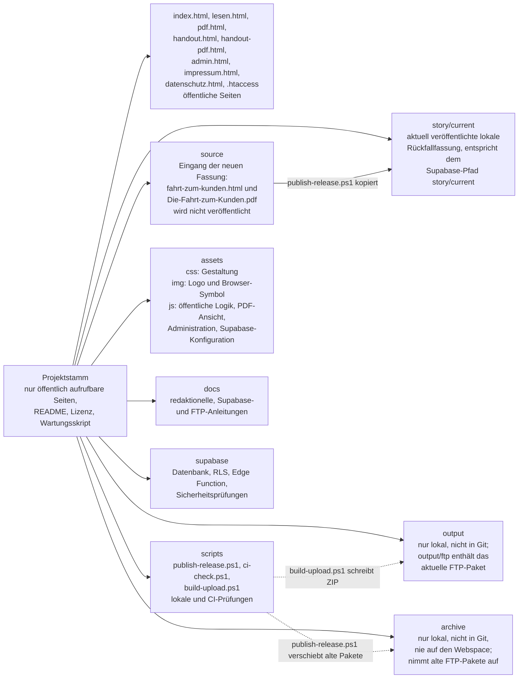

# Repo-Struktur und Release-Ablauf

Diese Seite soll neuen Mitwirkenden und neuen Sitzungen in fünf Minuten zeigen, wo was liegt und wie eine neue Fassung von „Die Fahrt zum Kunden“ live geht. Jede Aussage in den Diagrammen ist in der Belegtabelle darunter mit Datei und Zeile belegt.

Kennzeichnungen:

- **offen**: noch nicht im Repository geregelt oder nicht belegbar.
- **gilt ab Merge von PR #8**: Die Aussage stammt aus dem offenen Pull Request #8 (Branch `auftrag-R02-veroeffentlichung`) und ist auf `main` noch nicht vorhanden. Zeilenangaben mit dem Zusatz „PR #8“ beziehen sich auf den Stand dieses Branches.

Zeilenangaben ohne Zusatz beziehen sich auf `main` (Stand 2f8cd6d).

## 1. Verzeichnis- und Dateikarte

## 2. Release-Ablauf von der Quelle bis zur Live-Seite

Verantwortliche: **Bernd/Owner** (Handarbeit), **Skript** (lokal von Bernd gestartet), **CI** (GitHub Actions, Workflow „Website prüfen“).

```mermaid
flowchart TD
    A["Bernd/Owner<br/>Neue Fassung als<br/>source/fahrt-zum-kunden.html ablegen"]
    B["Bernd/Owner<br/>PDF erzeugen und als<br/>source/Die-Fahrt-zum-Kunden.pdf ablegen<br/>OFFEN: Werkzeug kommt mit R14"]
    C["Bernd/Owner startet<br/>scripts/publish-release.ps1"]
    D["Skript<br/>prüft Version, Datum, Historie, PDF-Kennung,<br/>liest Seitenzahl mit pdfinfo"]
    E["Skript<br/>kopiert source nach story/current,<br/>setzt Rückfallwerte in app.js,<br/>lesen.html und index.html"]
    F["Skript<br/>ruft ci-check.ps1 auf"]
    G["Skript<br/>verschiebt alte Pakete nach archive,<br/>build-upload.ps1 prüft erneut und baut<br/>ZIP mit Manifest in output/ftp"]
    H["Skript<br/>gibt Übergabe an den Admin-Bereich aus:<br/>Version, Datum, Seitenzahl, Dateien,<br/>Handout geändert, FTP-Upload nötig<br/>gilt ab Merge von PR 8"]
    I["Bernd/Owner<br/>Branch und Pull Request auf main"]
    J["CI<br/>Website prüfen: ci-check.ps1,<br/>JavaScript-Syntax, Git-Historie,<br/>Whitespace"]
    K["Bernd/Owner<br/>merged nach grüner CI"]
    L["Bernd/Owner<br/>admin.html: Anmeldung mit MFA,<br/>Version, Datum, Seitenzahl eintragen,<br/>HTML und PDF wählen, Handout nur bei Änderung<br/>STANDARDWEG"]
    M["Supabase<br/>ersetzt Dateien unter stabilen Adressen<br/>und aktualisiert Versionsangaben"]
    N{"Geändert: index.html, assets/js,<br/>impressum.html oder datenschutz.html?<br/>Liste gilt ab Merge von PR 8"}
    O["Bernd/Owner<br/>FTP-Upload des Pakets aus output/ftp<br/>von Hand nach DomainFactory"]
    P["Bernd/Owner<br/>Live-Prüfung der öffentlichen<br/>Landingpage im privaten Browserfenster"]

    A --> B --> C --> D --> E --> F --> G --> H --> I --> J --> K --> L --> M --> N
    N -- "ja" --> O --> P
    N -- "nein" --> P

    classDef owner fill:#e8f0fe,stroke:#3367d6,color:#000
    classDef skript fill:#e6f4ea,stroke:#188038,color:#000
    classDef ci fill:#fef7e0,stroke:#b06000,color:#000
    classDef offen fill:#fce8e6,stroke:#c5221f,color:#000,stroke-dasharray: 5 5
    classDef pr8 fill:#e6f4ea,stroke:#c5221f,color:#000,stroke-dasharray: 5 5
    class A,C,I,K,L,O,P owner
    class D,E,F,G skript
    class J ci
    class B offen
    class H pr8
```

Legende: blau Bernd/Owner, grün Skript, gelb CI, rot hinterlegt und gestrichelt offen, grün mit rot gestricheltem Rand Skript-Schritt, der erst ab Merge von PR #8 gilt. Supabase (M) ist kein Verantwortlicher, sondern das Zielsystem des Admin-Bereichs.

Hinweis zur Reihenfolge: Das Repository legt nicht ausdrücklich fest, ob der Upload über `admin.html` vor oder nach dem Merge erfolgt. Die Reihenfolge „Pull Request, dann Admin-Bereich“ folgt `docs/NEUE-GESCHICHTE.md` (Schritte 4 und 5) und gilt ab Merge von PR #8. Auf `main` ist sie **offen**.

## Belegtabelle

### Verzeichniskarte

| Aussage | Quelle (Datei:Zeile) |
|---|---|
| Projektstamm enthält nur öffentlich aufrufbare Seiten, README, Lizenz und Wartungsskript | README.md:18 |
| Liste der öffentlichen Seiten im Projektstamm | scripts/build-upload.ps1:39-40; scripts/ci-check.ps1:9 |
| `source` enthält die ursprünglichen Quelldateien, die nicht veröffentlicht werden | README.md:16 |
| Dateinamen in `source` sind fest vorgegeben | README.md:26-27; scripts/publish-release.ps1:13-14 |
| `story/current` ist die lokale Rückfallfassung und entspricht dem Supabase-Pfad | README.md:13 |
| `publish-release.ps1` kopiert `source` nach `story/current` | scripts/publish-release.ps1:85-86 |
| `scripts` enthält lokale und CI-Prüfungen | README.md:15 |
| Inhalt von `assets` (css, img, js) | README.md:9-11 |
| `docs` enthält redaktionelle, Supabase- und FTP-Anleitungen | README.md:14 |
| `supabase` enthält Datenbank, RLS, Edge Function und Sicherheitsprüfungen | README.md:17 |
| `archive` nur lokal, nicht in Git, nie auf den Webspace | README.md:12, README.md:20; .gitignore:2-3 |
| Alte FTP-Pakete werden nach `archive/ftp-packages` verschoben | scripts/publish-release.ps1:113-123 |
| `output` ist nicht in Git | .gitignore:5 |
| `build-upload.ps1` schreibt das ZIP nach `output/ftp` | scripts/build-upload.ps1:30-32, 73 |

### Release-Ablauf

| Aussage | Quelle (Datei:Zeile) |
|---|---|
| A: Neue HTML-Datei als `source/fahrt-zum-kunden.html` ablegen | README.md:26 |
| B: Passende PDF als `source/Die-Fahrt-zum-Kunden.pdf` ablegen | README.md:27 |
| B: Wie die PDF aus der HTML-Datei erzeugt wird, ist im Repository nicht geregelt: **offen** (Werkzeuge folgen mit Auftrag R14). PR #8 sagt nur „wird aus der HTML-Datei erzeugt“ | docs/NEUE-GESCHICHTE.md:22 (PR #8) |
| C: Bernd startet nur `./scripts/publish-release.ps1`, keine Handkopien | README.md:28-33 |
| D: Prüfung von Version, Datum und Versionshistorie | scripts/publish-release.ps1:24-50 |
| D: Prüfung der PDF-Kennung | scripts/publish-release.ps1:55-62 |
| D: Seitenzahl per `pdfinfo`, ersatzweise `-PageCount` | scripts/publish-release.ps1:66-78 |
| E: Kopie nach `story/current` erst nach allen Eingangsprüfungen | scripts/publish-release.ps1:84-86 |
| E: Rückfallwerte in `app.js`, `lesen.html`, Seitenzahl in `index.html` | scripts/publish-release.ps1:88-107; README.md:37 |
| F: `publish-release.ps1` ruft `ci-check.ps1` auf | scripts/publish-release.ps1:109 |
| F: `ci-check.ps1` prüft u. a. Gleichstand von Version, Datum, Seitenzahl und bytegenaue Übereinstimmung `source` / `story/current` | scripts/ci-check.ps1:106-189 |
| G: Alte Pakete wandern ins Archiv | scripts/publish-release.ps1:111-123 |
| G: `build-upload.ps1` wird aufgerufen | scripts/publish-release.ps1:125 |
| G: `build-upload.ps1` prüft vorher erneut mit `ci-check.ps1` | scripts/build-upload.ps1:10-11 |
| G: ZIP mit `UPLOAD-MANIFEST.txt` und SHA-256, bytegenaue Nachkontrolle | scripts/build-upload.ps1:59-105; README.md:59-64 |
| H: Admin-Übergabe (Version, Datum, Seitenzahl, Dateien, Handout, FTP-Bedarf): **gilt ab Merge von PR #8**, auf `main` endet das Skript mit der OK-Zeile | scripts/publish-release.ps1:127 (main); scripts/publish-release.ps1:170-227 (PR #8) |
| I: Änderungen an `main` nur über Pull Request mit erfolgreicher CI | README.md:93 |
| I: Konkrete Branch- und PR-Befehle für eine neue Fassung: **gilt ab Merge von PR #8** | docs/NEUE-GESCHICHTE.md:54-62 (PR #8) |
| J: CI läuft bei Push auf `main`, bei Pull Requests und manuell | .github/workflows/ci.yml:4-9; README.md:93 |
| J: CI-Schritte ci-check, JavaScript-Syntax, Git-Historie, Whitespace | .github/workflows/ci.yml:35-55 |
| J: CI führt kein Deployment aus | README.md:5; .github/workflows/ci.yml:3 |
| K: Gemergt wird nur durch den Owner: **gilt ab Merge von PR #8** | docs/NEUE-GESCHICHTE.md:64 (PR #8) |
| L: Ablauf im Admin-Bereich (Anmeldung, Authenticator-Code, Version, Datum, Seitenzahl, PDF und HTML, Handout falls geändert) | README.md:46-50 |
| L: Admin-Bereich mit Supabase ist der **Standardweg**: **gilt ab Merge von PR #8**; auf `main` sinngemäß „für eine neue Fortsetzung kein DomainFactory-Upload nötig“ | README.md:24 (PR #8); docs/NEUE-GESCHICHTE.md:3 (PR #8); README.md:67 (main) |
| M: Supabase ersetzt Dateien unter stabilen Adressen und aktualisiert Versionsangaben | README.md:67 |
| N: FTP nur bei Änderungen an `index.html`, `assets/js`, `impressum.html`, `datenschutz.html`: **gilt ab Merge von PR #8** | README.md:24 (PR #8); scripts/publish-release.ps1:199-200 (PR #8) |
| N: Auf `main` lautet die Regel „nur Änderungen an der Landingpage selbst“ beziehungsweise „Landingpage, Gestaltung, JavaScript, Impressum oder Datenschutz“ | README.md:67; docs/DOMAINFACTORY-DEPLOYMENT.md:57 |
| O: FTP-Upload erfolgt manuell zu DomainFactory | README.md:5; docs/DOMAINFACTORY-DEPLOYMENT.md:3 |
| O: Paket liegt in `output/ftp`, Upload von Hand | README.md:41-42; scripts/publish-release.ps1:216 (PR #8) |
| P: Nach dem Veröffentlichen die öffentliche Landingpage prüfen | README.md:51 |
| P: Prüfung im privaten Browserfenster | docs/DOMAINFACTORY-DEPLOYMENT.md:36; docs/NEUE-GESCHICHTE.md:75 (PR #8) |

## Offene Punkte

- PDF-Erzeugung aus der HTML-Datei: Werkzeug und Befehl fehlen im Repository (Auftrag R14).
- Reihenfolge Merge und Admin-Upload ist auf `main` nicht festgelegt.
- FTP-Regel: PR #8 nennt vier Pfade; `docs/DOMAINFACTORY-DEPLOYMENT.md:57` nennt zusätzlich „Gestaltung“ (`assets/css`). PR #8 meldet weitere geänderte öffentliche Dateien nur als Hinweis (scripts/publish-release.ps1:224-226, PR #8). Die beiden Aussagen sollten angeglichen werden.
- Nach dem Merge von PR #8 müssen die Kennzeichnungen „gilt ab Merge von PR #8“ und die Zeilenangaben dieser Seite aktualisiert werden.
