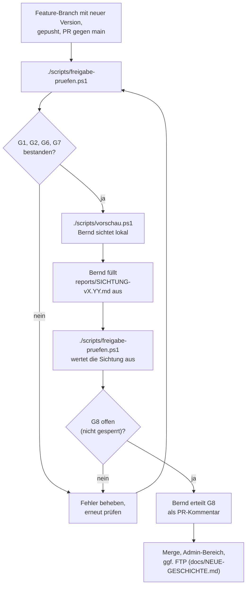

# Freigabe einer neuen Version

Jede neue Version von „Die Fahrt zum Kunden“ und jede Änderung an der Website durchläuft vor der Freigabe die Tore G1 bis G8 (Entscheidung Bernd, 08.11.2026). Bernd muss die Version vor der Freigabe lokal selbst sichten können. Die maschinenlesbare Fassung der Tore steht in [freigabe.yaml](freigabe.yaml).

Quelle der Tore: Auftrag R43. Ein Entwurf `freigabe.yaml` bzw. der Reiter „Freigabe“ der Abstimmungsseite lag im Repository nicht vor; Tore, Prüfungen und Nachweise sind aus dem Auftrag abgeleitet und sollen bei Bedarf mit dem Entwurf abgeglichen werden.

## Regel

- Solange ein Tor **nicht bestanden**, **offen** oder **gesperrt** ist, gibt es keinen Merge nach `main`, keinen Tag und keinen Upload (weder Admin-Bereich noch FTP).
- G3, G4, G5 und G8 haben keine Automatik. `scripts/freigabe-pruefen.ps1` gibt sie nie als bestanden aus.
- G8 erteilt ausschließlich Bernd. G8 bleibt gesperrt, solange eine automatische Prüfung nicht bestanden oder offen ist (eine Prüfung mit „nicht zutreffend“ sperrt nicht) oder die Sichtungsliste einen Nein-Punkt oder einen leeren Punkt enthält.
- „Bestanden“ gilt nur mit Beleg (Befehl und Ergebnis im Freigabebericht, PR, CI-Lauf).

## Tore

| Tor | Name | Automatik | Prüfung | Nachweis |
|---|---|---|---|---|
| G1 | Code | ja | `scripts/ci-check.ps1`, `node --check` für `assets/js/*.js`, Pester-Tests unter `tests/` | Freigabebericht |
| G2 | Kommentare | ja | Jedes Skript unter `scripts/` erklärt sich in den ersten zehn Zeilen; Pull Request ohne Review-Status „Änderungen angefordert“ (per `gh`) | Freigabebericht |
| G3 | Layout | nein | PDF: Deckblatt, neue Szene, Codebox, SVG-Seite, Mini-TOC, Seitenzahl | Sichtungsliste, Abschnitt PDF |
| G4 | UI | nein | Startseite, Lesefassung, Handout, Datenschutz, Impressum, Podcast-Player je in 390, 768 und 1280 px | Sichtungsliste, Abschnitt Webseiten |
| G5 | Inhalt | nein | Neue Szene gelesen; Versionshistorie und „Neu in vX.YY“ zutreffend | Sichtungsliste, Abschnitt Inhalt |
| G6 | Lokal | ja | Podcast-MP3 gegen `assets/audio/SHA256SUMS.txt` (bei einem Upload-Paket ohne Audio nicht zutreffend); lokale Vorschau möglich (`scripts/vorschau.ps1`, Python) | Freigabebericht |
| G7 | Git | ja | `git status` sauber; Feature-Branch gleich `origin`; offener PR gegen `main`, kein Draft, alle Checks grün (per `gh`) | Freigabebericht |
| G8 | Freigabe Bernd | nein | Ausdrückliche Freigabe, z. B. PR-Kommentar „Freigabe G8 vX.YY: ja“ | PR-Kommentar |

Ergebniswerte: **bestanden**, **nicht bestanden**, **offen** (keine Automatik oder Prüfung nicht ausführbar, z. B. ohne lokale MP3 oder ohne `gh`), **nicht zutreffend** (Prüfung gilt für diesen Stand nicht, mit Begründung; zählt nicht gegen das Tor), **gesperrt** (nur G8).

## Rollen

| Rolle | Aufgabe |
|---|---|
| Bernd/Owner | Startet Vorschau und Freigabeprüfung, füllt die Sichtungsliste aus, erteilt G8, merged, lädt hoch |
| Skript | `scripts/freigabe-pruefen.ps1` prüft G1, G2, G6, G7 und schreibt Freigabebericht und Sichtungsliste; `scripts/vorschau.ps1` stellt die lokale Vorschau bereit |
| CI | GitHub Actions „Website prüfen“; das Ergebnis geht über `gh` in G7 ein |
| Claude/Agent | Bereitet Branch und PR vor, darf G3, G4, G5 und G8 nicht setzen, merged nicht |

## Ablauf



### 1. Freigabeprüfung

Im Projektordner auf dem Feature-Branch:

```powershell
./scripts/freigabe-pruefen.ps1
```

Das Skript schreibt `reports/FREIGABE-vX.YY.md` (Tabelle Tor, Ergebnis, Nachweis und alle Einzelprüfungen) und legt beim ersten Lauf `reports/SICHTUNG-vX.YY.md` an. Die Version kommt aus dem Deckblatt von `source/fahrt-zum-kunden.html`. `reports/` ist in `.gitignore` eingetragen; die Berichte bleiben lokal und werden nicht in `main` committet. Exit-Code 1 bedeutet: mindestens eine automatische Prüfung nicht bestanden. Exit-Code 0 bedeutet **nicht** Freigabe.

Wichtige Schalter:

- `-Projekt <Pfad>`: prüft einen anderen Worktree, z. B. einen Release-Zweig, ohne dort etwas zu ändern (dann zusätzlich `-AusgabeOrdner` außerhalb dieses Worktrees angeben).
- `-AudioOrdner <Pfad>`: Ordner mit den lokalen Podcast-MP3, falls sie nicht unter `assets/audio` liegen.
- `-Paket <Pfad>`: Upload-Paket aus `scripts/build-upload.ps1` (ZIP oder Ordner). Ohne Angabe nimmt das Skript das jüngste `output/ftp/relingit-upload-vX.YY-*.zip` der geprüften Version. Ist das Paket ohne Audio gebaut (Name endet auf `-ohne-audio` oder `UPLOAD-MANIFEST.txt` enthält „Ohne Audio:“), ist die MP3-Prüfung in G6 **nicht zutreffend** (Entscheidung Bernd, 10.11.2026): Die Live-MP3 bleiben beim Upload unverändert. Enthält ein so gekennzeichnetes Paket doch MP3, ist die Prüfung nicht bestanden. Bei einem Paket mit Audio oder ohne Paket werden die lokalen MP3 wie bisher gegen `SHA256SUMS.txt` geprüft.
- `-OhnePester`, `-OhneGh`: Teilprüfungen auslassen; das betroffene Tor ist dann offen, nie bestanden.

### 2. Lokale Vorschau

```powershell
./scripts/vorschau.ps1            # Port 8043, öffnet index.html
./scripts/vorschau.ps1 -Port 8100 -Pdf
```

Das Skript kopiert die öffentlichen Dateien (Liste aus `scripts/build-upload.ps1`) in einen temporären Ordner außerhalb des Repositorys, schaltet in der Kopie Supabase ab (die Seiten zeigen die lokale Rückfallfassung dieses Zweigs), startet `python -m http.server` ausschließlich auf `127.0.0.1` und öffnet die Startseite. Strg+C beendet den Server und löscht die Kopie. Kein FTP, keine Zugangsdaten, kein Netzwerkzugriff außer dem lokalen Server. Ohne lokale MP3 zeigt der Podcast-Player nur die Darstellung.

### 3. Sichtung

Bernd trägt in `reports/SICHTUNG-vX.YY.md` je Prüfpunkt **Ja** oder **Nein** ein, bei Nein mit Bemerkung. Breiten stellt man im Browser über die Entwicklerwerkzeuge ein (Strg+Umschalt+I, dann Strg+Umschalt+M). Das Skript überschreibt eine vorhandene Sichtungsliste nie; ein erneuter Lauf wertet sie aus. Die Liste ist der Nachweis für G3, G4 und G5.

### 4. Freigabe G8

Ist G8 im Freigabebericht **offen** (nicht gesperrt), erteilt Bernd die Freigabe als Kommentar im Pull Request, z. B. „Freigabe G8 v1.38: ja“, und hängt Freigabebericht und Sichtungsliste an oder fasst sie zusammen. Danach folgen Merge und Veröffentlichung nach [NEUE-GESCHICHTE.md](NEUE-GESCHICHTE.md).
