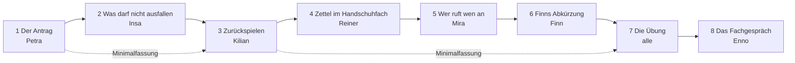

# Idee 20 · Noras Abschlussprojekt: ISMS und Notfallhandbuch für Reling IT

```yaml
Stand: 2026-11-28
Status: Konzept (Vorschlag des Planers, nichts eingeplant, keine ausformulierte Prosa)
Anlass: Idee des Autors vom 28.11.2026
Kern: Die Auszubildende bekommt für ihre Abschlussarbeit eine neue Aufgabe. ISMS und Notfallhandbuch werden zur gemeinsamen Aufgabe des kleinen Systemhauses. Sie hat dafür sechs Monate, grübelt, forscht und führt Gespräche mit allen im Haus.
Form: mehrere Episoden (Teil 1), Grundzüge der Dokumente und Beitrag der Agenten im Anhang (Teil 2)
Nummerierung: setzt die Ideen 13 bis 19 fort
Hinweis: keine Rechts-, Prüfungs- oder Zertifizierungsberatung; reale Vorgaben sind vor dem Schreiben am Primärtext zu prüfen
```

## 1. Einschätzung

Die Idee trägt, und zwar aus vier Gründen:

1. **Nora bekommt einen eigenen Bogen.** Bisher fragt sie („Und was macht ihr, wenn er sich irrt?“). Jetzt muss sie selbst Antworten aufschreiben, für die andere geradestehen.
2. **Das Gesprächsformat löst das Vortragsproblem.** Ein ISMS als Sachtext wäre ein Vortrag. Als Reihe von Gesprächen bekommt jede Figur eine Szene, und das Fachwissen entsteht aus Widerspruch und Alltag.
3. **Die Geschichte dreht die Blickrichtung um.** Das Systemhaus berät Kunden zur Sicherheit und hat sein eigenes Haus nie aufgeschrieben. Das ist ehrlich, verbreitet und erzählbar.
4. **Die Agenten bekommen eine klare Grenze.** Ein Notfallhandbuch muss gerade dann funktionieren, wenn Navis und Lumen nicht erreichbar sind. Das passt zur Leitlinie: Gewinn und Preis in derselben Szene.

Die größte Gefahr ist die Stofffülle. Ein ISMS wird nie „fertig“, die Projektarbeit aber hat ein hartes Zeitlimit. Genau daraus entsteht die erste Spannung (Abschnitt 3).

## 2. Geprüfte Fakten (Abruf 28.11.2026)

| Thema | Befund | Quelle |
|---|---|---|
| Projektarbeit Fachinformatiker Systemintegration | höchstens 40 Stunden; Projektantrag mit Phasen und Zeitplan, Genehmigung durch den Prüfungsausschuss; Dokumentation höchstens 10 Seiten plus Anlagen; Präsentation höchstens 15 Minuten, Fachgespräch insgesamt höchstens 30 Minuten; betrieblicher Auftrag, eigene Leistung | IHK Ostbrandenburg, Hinweise zur betrieblichen Projektarbeit (Details je Kammer verschieden) |
| NIS-2-Umsetzung in Deutschland | Gesetz am 6. Dezember in Kraft getreten (laut einer zweiten Quelle 06.12.2025); „wichtige Einrichtung“ ab 50 Beschäftigten oder Umsatz und Bilanz je über 10 Mio. Euro; Pflicht, Lieferanten und Dienstleistern vertraglich Sicherheitsanforderungen aufzugeben | Handelskammer Hamburg; usd.de (nur Titel gelesen) |
| CyberRisikoCheck (DIN SPEC 27076) | für kleine und Kleinstunternehmen; 27 Anforderungen in sechs Themenbereichen; Interview von ein bis zwei Stunden durch einen IT-Dienstleister; Bericht mit Punktzahl und Handlungsempfehlungen; keine Zertifizierung; laut BSI sind IT-Grundschutz und ISO/IEC 27001 für Firmen unter 50 Beschäftigten schlecht geeignet | BSI |
| Nicht geprüft | CISIS12, VdS 10000, BSI-Standard 200-4 (Notfallmanagement), Muster-IT-Notfallplan der IHK München: nur als Suchtreffer gesehen, Inhalte vor dem Schreiben lesen | offen |

Folgerung für die Erzählwelt: Reling IT (acht Menschen) fällt nach den Schwellenwerten voraussichtlich nicht selbst unter das Gesetz. Die Kunden können die Anforderungen aber über Verträge weiterreichen. Das ist der glaubwürdige äußere Anlass. Ob ein kleiner IT-Dienstleister im Einzelfall doch betroffen ist, ist eine Fachfrage und bleibt im Buch eine offene Frage.

## 3. Zuschnitt: Was ist die Abschlussarbeit, was die gemeinsame Aufgabe?

40 Stunden reichen nicht für ISMS und Notfallhandbuch. Das ist kein Fehler der Idee, sondern ihr Motor: Petra will alles, die Prüfungsordnung erzwingt einen Schnitt.

| Variante | Projektarbeit (40 Stunden) | Gemeinsame Aufgabe des Hauses | Bewertung |
|---|---|---|---|
| **A (Empfehlung)** | Notfallhandbuch Version 1.0 für die wichtigsten Abläufe, mit einer Übung am Tisch | ISMS als Rahmen: Petra verantwortet, Kilian liefert Technik, Nora führt die Gespräche | klarer Abschluss, prüfbares Ergebnis, starke Schlussszene |
| B | ISMS-Einstieg: Geltungsbereich, Leitlinie, Inventar, Risikoliste | Notfallhandbuch später | fachlich sauber, erzählerisch trocken, kein Höhepunkt |
| C | CyberRisikoCheck am eigenen Haus als Bestandsaufnahme | daraus ISMS und Notfallhandbuch | guter Einstieg, aber die Punktzahl reibt sich an der Regel „keine Scores“ (Abschnitt 7) |

Empfehlung: Variante A, mit C als Auslöser in Episode 1 (eine Kundenanfrage, kein eigener Check).

## 3a. Sechs Monate (Vorgabe des Autors, 28.11.2026)

Nora hat sechs Monate für die Aufgabe. Das passt zur Episodenform: etwa ein Gespräch alle zwei bis drei Wochen. Die Projektarbeit der Kammer (höchstens 40 Stunden) ist ein Ausschnitt innerhalb dieser sechs Monate, nicht das Ganze.

| Monat | Was geschieht | Episoden |
|---|---|---|
| 1 | Auftrag, Grübeln, erste Recherche; Antrag und Zuschnitt | 1 |
| 2 | Bestandsaufnahme: Was darf nicht ausfallen, was ist gesichert | 2, 3 |
| 3 | Notfallkarte, Kontakte, Kommunikation | 4, 5 |
| 4 | Inventar: Berechtigungen, Automatisierungen, Navis und Lumen | 6, 6a |
| 5 | Projektarbeit im engeren Sinn (40 Stunden): Handbuch Version 1.0 und Übung | 7 |
| 6 | Dokumentation, Präsentation, Fachgespräch; Übergabe der Pflege an das Haus | 8 |

Zu klären: Ist die „Abschlussarbeit“ die Projektarbeit der Kammer (dann 40 Stunden innerhalb der sechs Monate) oder eine frei erzählte betriebliche Aufgabe ohne Bezug zur Prüfungsordnung?

## 4. Episoden (Vorschlag, acht Keime)

Jede Episode ist ein Gespräch von Nora mit einer Person im Haus. Aufbau je Episode: Gewinn, Preis, offene Frage.

| Nr | Arbeitstitel | Gespräch mit | Fachkern | Gewinn / Preis / offene Frage |
|---|---|---|---|---|
| 1 | Der Antrag | Petra | Geltungsbereich, Leitlinie, Verantwortung der Leitung | Petra will „alles“. Nora rechnet 40 Stunden vor. Preis: Ein Teil bleibt liegen. Offen: Wer macht den Rest? |
| 2 | Was darf nicht ausfallen? | Insa | kritische Abläufe, tolerierbare Ausfallzeit, Wissen in Köpfen | Der Rechnungslauf hängt an Insa allein. Preis: Aufschreiben kostet Insa Zeit, die sie nicht hat. Offen: Wer vertritt Insa? |
| 3 | Zurückspielen | Kilian | Backup ist nicht Wiederherstellung, Wiederanlaufreihenfolge | Echo auf „Erst das Fundament, dann der Anbau“. Preis: Eine Probe kostet einen Samstag. Offen: Wie oft ist oft genug? |
| 4 | Der Zettel im Handschuhfach | Reiner | Notfallkarte auf Papier, Erreichbarkeit ohne Netz | Reiner hat längst einen Zettel. Preis: Er ist drei Jahre alt. Offen: Wer pflegt Papier? |
| 5 | Wer ruft wen an? | Mira | Kommunikation im Notfall, Zusagen an Kunden, Nachweise in der Lieferkette | Ein Kunde fragt nach einem Nachweis. Preis: Ein ehrliches „noch nicht“. Offen: Was darf der Vertrieb versprechen? |
| 6 | Finns Abkürzung | Finn | Berechtigungen, Automatisierungen im Inventar | Knüpft an Idee 13, Keim C an. Preis: Ein bequemer Zugang fällt weg. Offen: Wer prüft die Prüfer? |
| 7 | Die Übung | alle | Übung am Tisch, Rollen im Notfall | Im Szenario sind Navis und Lumen nicht erreichbar. Das Handbuch muss ohne sie tragen. Preis: Die erste Fassung fällt an drei Stellen durch. Offen: Wann üben wir wieder? |
| 8 | Das Fachgespräch | Enno | Präsentieren, Awareness, Schulung | Enno übt mit Nora die 15 Minuten. Ihre eigene Frage kommt zurück: „Und was machen Sie, wenn es sich irrt?“ Offen bleibt das Ergebnis der Prüfung. |

Minimalfassung für eine erste Veröffentlichung: Episoden 1, 3 und 7 (Antrag, Technik, Übung). Die übrigen lassen sich einzeln nachschieben, eine Episode je Version, wie im etablierten Vorgehen.



## 4a. Noras Leitfragen (Ergänzung des Autors, 28.11.2026)

Zwischen den Gesprächen sitzt Nora am Schreibtisch, grübelt und forscht (BSI-Unterlagen, Kammer-Hinweise). Das ist das wiederkehrende Motiv: Jede Episode beginnt mit einer Frage, die sie allein nicht lösen kann, und deshalb geht sie zu jemandem im Haus.

| Leitfrage | Worum es geht | Richtung der Antwort (Vorschlag, im Buch offen gehalten) |
|---|---|---|
| „Wir sind klein und brauchen keine Auditfähigkeit. Also?“ | Die Regelwerke sind für große Häuser geschrieben. Was bleibt übrig, wenn niemand ein Zertifikat verlangt? | Maßstab ist nicht „auditfähig“, sondern „angemessen und im Ernstfall brauchbar“: Was muss am Montag nach einem Ausfall wieder laufen, wer entscheidet, wo steht es. Aufgeschrieben wird, was jemand anderes im Notfall braucht, nicht was ein Prüfer sehen will. Preis: Ohne Audit prüft niemand von außen. Wer prüft dann? (führt zur Übung, Episode 7) |
| „Was heißt KI-Governance in diesem Zusammenhang?“ | Navis und Lumen gehören zum Haus. Gehören sie auch ins ISMS? | Ja, als Werte im Inventar wie jedes andere System: Wer darf welche KI wofür einsetzen, mit welchen Daten, wer gibt frei, was geschieht bei einem Irrtum oder Ausfall. Die Leserolle (nur lesen, keine Scores, „So anlegen“) ist bereits eine Governance-Regel, sie stand nur nie im ISMS. Das ISMS regelt den Betrieb, die Standards-Familie regelt die Entwicklung der KI; die Brücke ist ein Eintrag im Inventar und ein Szenario im Notfallhandbuch („Navis und Lumen fallen aus oder irren“). |

Daraus folgt eine Schärfung der Episoden:

- **Episode 1 (Der Antrag)** bekommt die Frage nach der Auditfähigkeit als Kern: Petra sagt „Wir brauchen kein Zertifikat“, Nora fragt „Was brauchen wir dann?“.
- **Neue Episode 6a „Zehn im Haus“ (Gespräch mit Kilian oder Petra, und mit Navis selbst):** Nora trägt Navis und Lumen ins Inventar ein und fragt Navis, was es über sich selbst weiß. Navis kann sagen, was es liest, aber nicht, wo seine Antworten entstehen. Das ist die KI-Governance-Szene: Verantwortung liegt beim Menschen, der einträgt und freigibt.
- **Episode 7 (Die Übung)** prüft beide Leitfragen zugleich: kein Auditor, also üben; keine Agenten im Szenario, also Papier.

Anhang, zusätzliche Box 6: **KI-Governance im kleinen Haus:** Inventar der KI-Systeme, erlaubte Zwecke, Datenklassen, Freigabe durch Menschen, Verhalten bei Irrtum und Ausfall, Verweis auf die Standards der KI-Entwicklung. Realer Bezug: Der Entwurf „KI-Agenten in Apps“ der Standards-Familie behandelt die Entwicklungsseite; ob und wie er zitiert wird, entscheidet der Autor.

## 4b. Anregungen aus einem realen Pflichtenheft (Autor, 28.11.2026)

Der Autor hat ein reales, internes Pflichtenheft für ein Notfallhandbuch und ein Kurzhandbuch Informationssicherheit als Anregung gegeben. Übernommen werden nur Bauprinzipien, ohne Firma, Termine und Zahlen des Originals.

| Bauprinzip | Was es für die Geschichte bedeutet | Wo |
|---|---|---|
| Selbstauskunft mit Nachweisen, kein Zertifikat | Die Antwort auf Noras erste Leitfrage. Der Satz steht auf dem Deckblatt beider Handbücher. | Episode 1 |
| Jeder Abschnitt ist „belegt“, „erklärt“ oder „offen“ | Deckt sich mit „Offen bleibt offen“. Nora lernt, dass „offen“ ein ehrlicher Zustand ist und kein Makel. | Episoden 2, 5 |
| Keine Gesamtnote: Jeder Wert steht mit seiner Herkunft für sich | Deckt sich mit „keine Scores“. Lumen darf den Umsetzungsstand zeigen, aber nicht verdichten. | Episode 6a, Anhang |
| Zwei kurze Handbücher (je 10 bis 20 Seiten) mit gleichem Aufbau | Notfallhandbuch mit zehn Kapiteln, Kurzhandbuch Informationssicherheit mit acht. Klein genug für ein kleines Haus. | Anhang |
| Notbetrieb zuerst, Wiederanlauf danach | Erst klären, wie die drei wichtigsten Abläufe ohne eigene IT weiterlaufen. Das ist der Kern der Einstiegsstufe. | Episoden 2, 3 |
| Zwei Fassungen: intern und zur Vorlage bei Dritten | Die Fassung für Dritte enthält keine Kontaktdaten und keine Schwachstellen. Mira braucht genau diese Fassung. | Episode 5 |
| Gedruckt an festem Ort und außerhalb der eigenen IT abrufbar | Mindestens zwei Personen haben Zugang. Reiners Zettel wird zur Regel. | Episode 4 |
| Private Kontaktdaten nur mit Einwilligung | Die Kontaktliste ist kein Selbstläufer: Nora muss jede Person fragen. | Episode 4 |
| Tischübung von höchstens zwei Stunden vor der Freigabe | Ohne Übung keine Freigabe. Das Ergebnis steht im Handbuch. | Episode 7 |
| Erst die Inhalte von Hand, später die Erzeugung aus den Reports | Die Handbücher hängen nicht an der Software. Spätere Stufe: Daten in den Fachreports pflegen (Notfall, Nachweise, IT-Dokumentation) und die Handbücher daraus erzeugen. Das gibt Lumen eine Rolle und den Fachreports ihre erste Geschichte (Lücke aus Idee 18). | Episode 8 als Ausblick |
| Arbeit in Sitzungen zu zwei Stunden, die Leitung ist an wenigen beteiligt | Macht Petras Preis sichtbar: Auch die Chefin muss Zeit geben. | Episode 1 |

Offen: Soll die Erzählwelt die Fachreports für Notfall, Nachweise und IT-Dokumentation ausdrücklich nennen? Was die Reports real können, wird vorher an den Repos geprüft.

## 5. Was Navis und Lumen beitragen (und was nicht)

Die bestehenden Regeln gelten unverändert: nur lesen, keine Scores, Entwürfe brauchen ein menschliches „So anlegen“, Offen bleibt offen.

| Agent | Kann beitragen | Darf nicht | Vor dem Schreiben zu prüfen |
|---|---|---|---|
| Navis (liest nur das Sysingboard) | zeigen, welche Aufgaben und Verantwortlichkeiten notiert sind und wo eine Vertretung fehlt; einen Gliederungsentwurf vorbereiten, den Nora bestätigt; Noras Gesprächsfragen gegen den notierten Stand halten | schreiben, Risiken bewerten, eine Sicherheitsampel bilden, Risiken „akzeptieren“ (das ist Petras Entscheidung) | welche Daten das Sysingboard real enthält (AVKK passt inhaltlich zu Rollen im ISMS; nichts erfinden) |
| Lumen (liest nur über den Hub) | sagen, welche Nachweise in den Reports vorliegen und welche nicht; ehrlich „weiß ich nicht“ | einen Reifegrad oder eine Gesamtzahl bilden, Lücken schönrechnen | welche Reports welche Nachweise real tragen |
| beide | Entwürfe und Prüffragen liefern | im Notfall vorausgesetzt werden: Das Handbuch liegt gedruckt vor und funktioniert ohne sie | Zugangsdaten gehören weder ins Handbuch noch in einen Prompt |

Erzählerischer Kern: Die Agenten helfen beim Aufschreiben, nicht beim Verantworten. Episode 7 macht das sichtbar.

## 6. Anhang (Teil 2): Vorschlag für Boxen

1. **ISMS in Grundzügen:** Geltungsbereich, Leitlinie, Rollen, Inventar der Werte, Risiken, Maßnahmen, Nachweise, regelmäßige Überprüfung. Ein Satz je Baustein, mit dem Beispiel aus der jeweiligen Episode.
2. **Notfallhandbuch, Inhalt:** Notfallkarte mit Sofortmaßnahmen; Alarmierung und Kontakte; Rollen im Notfall; kritische Abläufe und Reihenfolge des Wiederanlaufs; Wiederanlaufpläne; Kommunikation (Kunden, Behörden, Versicherung); Notbetrieb; Übung und Pflege.
3. **Wege für kleine Unternehmen:** CyberRisikoCheck, CISIS12, VdS 10000, IT-Grundschutz, ISO/IEC 27001. Je ein Satz, mit Prüfstand und Datum. Keine Empfehlung als Beratung.
4. **Was die Agenten beitragen und was nicht:** Tabelle aus Abschnitt 5.
5. **Die Projektarbeit in Zahlen:** 40 Stunden, 10 Seiten, 15 Minuten, mit Hinweis auf die zuständige Kammer.

Alle Beispiele sind erfunden. Der Anhang enthält keine einsetzbaren Vorlagen und keine realen Daten.

## 7. Leitplanken und Risiken

- **Zehn im Haus:** keine neue Figur. Der Prüfungsausschuss bleibt namenlos und zählt nicht mit. Die IHK ist real: Ihr wird nichts Erfundenes zugeschrieben.
- **Keine Scores:** Der CyberRisikoCheck liefert eine Punktzahl. Sie stammt aus einem genormten Interview unter Menschen, nicht von Navis oder Lumen. Wenn sie vorkommt, dann als Reibung in der Szene (Petra will die Zahl, Nora will die Liste dahinter).
- **Standards-Familie:** Die neun Standards der Erzählwelt regeln nur die KI-Entwicklung. ISMS und Notfallhandbuch betreffen den ganzen Betrieb. Beides darf nicht vermischt werden; ein Satz im Anhang stellt das klar.
- **Öffentliches Repository:** nur erfundene Schwachstellen, keine Hinweise auf reale Systeme, Konten oder Lücken.
- **Zeitlinie:** Nora ist im 2. Lehrjahr. Die Projektarbeit liegt am Ende der Ausbildung. Die Episoden können mit dem Antrag beginnen und über Monate laufen.
- **Vortragsgefahr:** Fachbegriffe stehen im Anhang, in der Szene nur das Gespräch.
- **Podcast:** Neuer Erzähltext heißt neue Podcast-Fassung (bestehende Regel).

## 8. Offene Fragen an den Autor (einzeln zu entscheiden)

0. Sechs Monate und 40 Stunden: Projektarbeit der Kammer als Ausschnitt der Sechs-Monats-Aufgabe, oder frei erzählt?
1. Zuschnitt: Variante A (Notfallhandbuch als Projektarbeit, ISMS als gemeinsame Aufgabe)?
2. Umfang der ersten Veröffentlichung: Minimalfassung (Episoden 1, 3, 7) oder alle acht?
3. Platzierung: neuer Abschnitt in Teil 1 des bestehenden Buches oder eigener zweiter Band?
4. Wer ist Noras Ausbilder im Haus (am Buchtext prüfen, sonst festlegen)?
5. Soll die Punktzahl des CyberRisikoChecks vorkommen?
6. Soll die Lieferkette (Kundenanfrage nach einem Nachweis) der äußere Anlass sein?
7. Reihenfolge gegenüber den bereits entschiedenen Ideen (13 B/C, 14, 17)?
8. KI-Governance: eigene Episode 6a („Zehn im Haus“) oder nur Anhang-Box?
9. Sollen die Fachreports (Notfall, Nachweise, IT-Dokumentation) als spätere Stufe in der Geschichte vorkommen?

## 9. Vorgehen

Unverändert: eine Episode nach der anderen einbauen, Rendering und Links prüfen, Stimmigkeit, Version, Personenliste, Inhaltsverzeichnis und Deckblatt-Boxen aktualisieren, erst dann die nächste. Freigabe jeder Version über die Tore G1 bis G8.

## Quellen

- IHK Ostbrandenburg, Hinweise zur betrieblichen Projektarbeit Fachinformatiker: https://www.ihk.de/ostbrandenburg/zielgruppeneinstieg-azubis-und-ausbilder/ausbildungsberufe-a-z/hinweise-zur-betrieblichen-projektarbeit-fachinformatiker-6601318
- Handelskammer Hamburg, NIS-2: https://www.handelskammer-hamburg.de/innovation-neue-maerkte/digitalisierung/nis-2-neue-pflichten-fuer-unternehmen-6813584
- usd.de, NIS2UmsuCG in Kraft (nur Titel): https://www.usd.de/nis2umsucg-offiziell-in-kraft/
- BSI, CyberRisikoCheck: https://www.bsi.bund.de/EN/Themen/Unternehmen-und-Organisationen/Informationen-und-Empfehlungen/KMU/CyberRisikoCheck/CyberRisikoCheck.html
