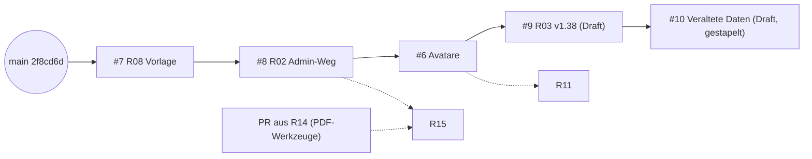

# R22 – Git-Hygiene: Branch- und PR-Inventar

Stand der Abfrage: `git fetch --prune` 05:05 Uhr, PR-Liste 05:07 Uhr, erneut geprüft 05:13 Uhr (keine Änderung, R14- oder R25-PR noch nicht vorhanden).

## Ergebnis

- 6 Remote-Branches (ohne `main`, `ops/queue`, `ops/reports`), alle direkt auf dem aktuellen `main` (2f8cd6d), keiner in `main` enthalten.
- Der Fetch hat die Branches der gemergten PRs #4 und #5 entfernt (bereits auf GitHub gelöscht); die Branches von #1 bis #3 existieren nicht mehr. **Keine Löschkandidaten.**
- 5 offene PRs (#6 bis #10, davon #9 und #10 Draft); alle textlich konfliktfrei gegen `main` und paarweise.
- CI rot bei #6 und #9 aus demselben Grund: `story/current/fahrt-zum-kunden.html` nicht aus `source/` neu erzeugt. #10 hat keine CI, weil die Basis nicht `main` ist.
- Empfohlene Reihenfolge: **#7 → #8 → #6 → #9 → #10**; Branch `quelle-pdf-werkzeuge-20261106` (R14) hat noch keinen PR.

### Remote-Branches

| Branch | Letzter Commit | Autor | Commits vor `main` | In `origin/main` | Per Squash enthalten (`git cherry`) | PR |
|---|---|---|---|---|---|---|
| geschichte-veraltete-daten-20261107 | 2026-11-07 04:55 | Claude | 3 (inkl. R03-Commit 1f49164) | nein | nein (3 ×`+`) | #10 (Draft, Basis #9) |
| quelle-pdf-werkzeuge-20261106 | 2026-11-06 18:39 | Claude | 1 | nein | nein | **keiner** (vermutlich R14) |
| auftrag-R03-buchtext-v138 | 2026-11-06 11:46 | Bernd Marnau | 1 | nein | nein | #9 (Draft) |
| auftrag-R02-veroeffentlichung | 2026-11-06 11:43 | Bernd Marnau | 3 | nein | nein | #8 |
| auftrag-R08-kapitel-vorlage | 2026-11-06 11:30 | Bernd Marnau | 2 | nein | nein | #7 |
| avatare-buch-und-seite-20261106 | 2026-11-06 11:25 | Claude | 2 | nein | nein | #6 |

Alle Branches sind 0 Commits hinter `main` (Merge-Basis 2f8cd6d = `origin/main`).

### PRs

| PR | Titel (gekürzt) | Basis | Status | Draft | CI „Website prüfen“ | Konflikt mit `main` (`merge-tree`) | Geänderte Dateien |
|---|---|---|---|---|---|---|---|
| #10 | Geschichte „Die veralteten Daten“ + Box „Datenstand“ | auftrag-R03-buchtext-v138 | offen | ja | keine (Workflow nur für PRs gegen `main`) | nein | source/fahrt-zum-kunden.html |
| #9 | R03: Buchtext v1.38, k1 bis k3 (PDF offen) | main | offen | ja | **FAILURE** | nein | source/fahrt-zum-kunden.html |
| #8 | R02: Veröffentlichung über Admin-Bereich | main | offen | nein | SUCCESS | nein | README.md, docs/DOMAINFACTORY-DEPLOYMENT.md, docs/NEUE-GESCHICHTE.md, scripts/ci-check.ps1, scripts/publish-release.ps1 |
| #7 | R08: Kapitel-Vorlage und Einbau-Checkliste | main | offen | nein | SUCCESS | nein | docs/vorlagen/* (neu) |
| #6 | Avatare für Navis, Lumen, Ancora | main | offen | nein | **FAILURE** | nein | assets/img/avatare/* (neu), source/fahrt-zum-kunden.html |
| #5 | Seitenzahl per Release-Skript | main | gemergt 06.11. 10:36 | – | SUCCESS | – | – |
| #4 | Auftrag A: Seitenzahl, Prüfbericht | main | gemergt 06.11. 10:34 | – | SUCCESS | – | – |
| #3 | Repo-Links auf Reling-IT/relingit | main | gemergt 27.10. | – | SUCCESS | – | – |
| #2 | Fix admin password recovery | main | gemergt 29.09. | – | SUCCESS | – | – |
| #1 | Harden public repository | main | gemergt 04.09. | – | SUCCESS | – | – |

CI-Fehler bei #6 (Lauf 42202550419) und #9 (Lauf 42205339010), jeweils einziger Fehler: „Veröffentlichungsfassung ist nicht aktuell: story/current/fahrt-zum-kunden.html weicht von source/fahrt-zum-kunden.html ab“.

Dateiüberschneidungen zwischen offenen PRs: nur `source/fahrt-zum-kunden.html` (#6, #9, #10). `git merge-tree --write-tree` für #6×#9, #6×#10, #9×#10 jeweils Exit 0 (konfliktfrei). `VERSION`, `README.md` und `scripts/ci-check.ps1` werden nur von je einem PR (#8) bzw. von keinem PR (`VERSION`) berührt.

### Löschkandidaten

| Branch | Grund | Befehl |
|---|---|---|
| – | Keine: alle verbliebenen Remote-Branches tragen offene PRs oder unveröffentlichte Arbeit (`quelle-pdf-werkzeuge-20261106`). | – |

Künftig nach jedem Merge (falls „Automatically delete head branches“ nicht aktiv ist): `git push origin --delete <branch>`. Lokal veraltete Tracking-Referenzen räumt `git fetch --prune` ab; lokale Branches prüfen mit `git branch -vv | grep ': gone]'`.

### Empfohlene Merge-Reihenfolge

| Position | PR | Begründung |
|---|---|---|
| 1 | #7 (R08) | Nur neue Dateien unter `docs/vorlagen/`, CI grün, keine Überschneidung. Kein Risiko. |
| 2 | #8 (R02) | CI grün, keine Dateiüberschneidung. Bringt den Vollständigkeits-Check der Buchquelle in `ci-check.ps1`, der danach #6 und #9 mitprüft. Voraussetzung für R15. |
| 3 | #6 (Avatare) | Voraussetzung für R11 (→ R12, R18). Vor dem Merge `story/current` neu erzeugen (CI rot), auf `main` mit #8 aktualisieren. Kleinere Änderung an `fahrt-zum-kunden.html` als #9/#10, daher zuerst. |
| 4 | #9 (R03, Draft) | Nach #6 auf `main` aktualisieren, `story/current` neu erzeugen, PDF ergänzen, Draft aufheben. |
| 5 | #10 (Draft) | Gestapelt auf #9. Nach Merge von #9 Basis auf `main` umstellen (geschieht beim Löschen des #9-Branches automatisch), dann läuft die CI. |
| (neu) | PR aus R14 (`quelle-pdf-werkzeuge-20261106`) | Nur `scripts/pdf/*` neu, keine Überschneidung; jederzeit mergebar. Zusammen mit #8 Voraussetzung für R15. |



PR-Kommentare mit Position und Überschneidungen: #7, #8, #6, #9, #10 (05:13 Uhr).

## Offene Fragen, Risiken, Abweichungen

- **Erzeugte Fassung `story/current/`:** #6, #9 und #10 ändern alle die Buchquelle. Die erzeugte Datei `story/current/fahrt-zum-kunden.html` fehlt in allen drei PRs; sobald sie nachgezogen wird, entstehen dort Konflikte zwischen den PRs, wenn sie nicht nacheinander (nach jedem Merge neu erzeugen) bearbeitet werden.
- **Semantische Prüfung:** `merge-tree` prüft nur Textkonflikte. Ob #6/#9 den neuen Vollständigkeits-Check aus #8 bestehen, ist ungeprüft (Leseauftrag, kein Checkout).
- **#10 enthält den R03-Commit:** Wird #9 per Squash gemergt, bleibt 1f49164 in #10 als eigener Commit sichtbar; textlich identisch, Git löst das in der Regel sauber auf, die Commit-Liste von #10 wirkt aber doppelt.
- **R14:** Branch `quelle-pdf-werkzeuge-20261106` existiert seit 06.11. 18:39 ohne PR. Ob das der R14-Stand ist, ist nicht bestätigt.
- Parallel laufende Agenten (R14, R25): Stand nach 05:13 Uhr nicht erfasst.
- Abweichung: Lokales `git show origin/main:<pfad>` scheitert in Git Bash an der Pfadumwandlung (MSYS); per PowerShell ausgeführt.

## Vorschläge und Ideen (Claude)

- In den GitHub-Einstellungen „Automatically delete head branches“ aktivieren; dann entfallen Löschkandidaten künftig.
- Den CI-Workflow zusätzlich für `pull_request` auf beliebige Basen laufen lassen (`branches: ['**']`), damit gestapelte PRs wie #10 geprüft werden.
- Einen kleinen Hinweis in `docs/NEUE-GESCHICHTE.md` (#8): „Nach jeder Änderung an `source/` die Veröffentlichungsfassung erzeugen“, oder einen Pre-Commit-Check, der denselben Vergleich wie `ci-check.ps1` lokal macht.
- Buch-PRs (#6, #9, #10) seriell abarbeiten, weil sie dieselbe Datei und dieselbe erzeugte Fassung ändern.

Hygiene: 0 gemergte Remote-Branches übrig (Löschkandidaten: keine), 5 offene PRs (#6–#10), davon 2 Drafts (#9, #10), 2 mit roter CI (#6, #9), 1 Branch ohne PR (`quelle-pdf-werkzeuge-20261106`).

```yaml
Reifegrad: 'Repo sauber; offene PRs konfliktfrei, aber zwei mit roter CI wegen fehlender erzeugter Fassung'
Projektstatus: 'v1.38-Buchfassung und Veröffentlichungsweg in PRs, warten auf Merge durch den Owner'
Offene_Fragen:
  - 'Ist quelle-pdf-werkzeuge-20261106 der R14-Stand, und wann folgt der PR?'
  - 'Soll story/current in den Buch-PRs mitgeführt oder erst beim Release erzeugt werden?'
  - 'Automatisches Löschen von Head-Branches aktivieren?'
Roadmap:
  Sprints_bis_BSF: 1
  Sprints_bis_MVP: 2
  Hinweis: 'unbelegte Schätzung'
```
