# R41 – Kontraste der Buchquelle anheben

## Ergebnis

- In `source/fahrt-zum-kunden.html` sind vier Farbtokens geändert und `opacity` bei `.tenure` entfernt. Dazu kommt ein CSS-Kommentar mit Begründung. Diff: 1 Datei, +7 −5. Buchtext, SVG-Farben, Versionsangaben, `story/current` und das PDF sind unverändert.
- Alle 17 geprüften Text-Paare liegen nachher bei mindestens 4,5:1. Vorher fielen 10 davon durch, mit Werten von 2,45 bis 4,46:1. Damit sind alle R31-Muss-Befunde der Buchquelle erfüllt (`--ink-soft`, `--ink-faint`, `--accent`, `.codebox`, `.tenure`, `.cover-toc-title`).
- `.codebox` ist über das Token `--surface-2` gelöst, nicht über eine eigene Regel. Das Token gilt auch für die Personen-Badges und die Abbildungen in „Realer Bezug“, die dasselbe Problem hatten. `--surface-2` liegt jetzt zwischen `--bg` und `--surface` statt heller als `--surface`. Nur so bestehen alle Textfarben, auch Navis-Türkis, Lumen-Gold und Grün.
- Draft-PR #33. Er geht nicht in v1.38 ein, weil das Upload-Paket unverändert bleibt.

| Token / Regel | vorher | nachher | Wirkung |
|---|---|---|---|
| `--ink-soft` | `#aab4cc` | `#c3cbdc` | heller, gleicher Blaugrau-Ton |
| `--ink-faint` | `#93a0ba` | `#b0bacd` | heller, gleicher Ton |
| `--accent` | `#8098ff` | `#a5b6ff` | helleres Periwinkle |
| `--surface-2` | `#24647e` | `#15455a` | dunkler, gleicher Petrol-Ton |
| `.person .tenure` | `opacity:.8` | deckend | – |

## Kontrasttabelle vorher/nachher

Berechnet mit der WCAG-2.x-Formel (relative Luminanz). Transparenz ist per Alpha-Mischung auf den Hintergrund gerechnet. Skript: `kontrast_r41.py` im Scratchpad der Sitzung, Ausgabe unverändert übernommen. Alle Texte sind 9,5–16px groß, deshalb gilt überall das Soll von 4,5:1.

| Vordergrund | Hintergrund | vorher | nachher | Soll | Ergebnis nachher | Fundstelle |
|---|---|---|---|---|---|---|
| `--ink-soft` `#aab4cc`→`#c3cbdc` | `--bg` `#123b4e` | 5,74:1 | 7,32:1 | 4,5:1 | bestanden | .subtitle, .cover-whatsnew, TOC-Links, .cover-meta b |
| `--ink-faint` `#93a0ba`→`#b0bacd` | `--bg` `#123b4e` | 4,53:1 | 6,10:1 | 4,5:1 | bestanden | .cover-meta, .part-divider, TOC-Label/.sep, footer, Untertitel |
| `--accent` `#8098ff`→`#a5b6ff` | `--bg` `#123b4e` | **4,46:1** | 6,09:1 | 4,5:1 | bestanden | .cover-toc-title (11px) |
| `--ink-soft` `#aab4cc`→`#c3cbdc` | `--surface` `#1b4f66` | **4,29:1** | 5,47:1 | 4,5:1 | bestanden | .disclaimer, .intro p, aside.real p, .appendix p, .defitem p, .name |
| `--ink-faint` `#93a0ba`→`#b0bacd` | `--surface` `#1b4f66` | **3,39:1** | 4,56:1 | 4,5:1 | bestanden | .role, appendix figcaption, .vtable th/Datum, .defbox-head |
| `--ink-faint` (×0,8 = `#7b90a9`)→`#b0bacd` | `--surface` `#1b4f66` | **2,72:1** | 4,56:1 | 4,5:1 | bestanden | .tenure (vorher opacity .8, nachher deckend) |
| `--accent` `#8098ff`→`#a5b6ff` | `--surface` `#1b4f66` | **3,33:1** | 4,55:1 | 4,5:1 | bestanden | .defitem .term, .vtable Version, aside.real Link |
| `--ink-soft` `#aab4cc`→`#c3cbdc` | `--surface-2` `#24647e`→`#15455a` | **3,16:1** | 6,35:1 | 4,5:1 | bestanden | .codebox pre, .badge (Initialen), Abbildungsunterschrift in aside.real |
| `--ink-faint` `#93a0ba`→`#b0bacd` | `--surface-2` `#24647e`→`#15455a` | **2,49:1** | 5,29:1 | 4,5:1 | bestanden | .codebox-head, .codebox .c |
| `--navis` `#4fd1c5` | `--surface-2` `#24647e`→`#15455a` | **3,52:1** | 5,54:1 | 4,5:1 | bestanden | .codebox .k, .badge.navis |
| `--ok` `#7bc493` | `--surface-2` `#24647e`→`#15455a` | **3,18:1** | 5,00:1 | 4,5:1 | bestanden | .codebox .s |
| `--lumen` `#e8b34c` | `--surface-2` `#24647e`→`#15455a` | **3,43:1** | 5,41:1 | 4,5:1 | bestanden | .badge.lumen |
| `--accent` `#8098ff`→`#a5b6ff` | `--surface-2` `#24647e`→`#15455a` | **2,45:1** | 5,29:1 | 4,5:1 | bestanden | Link in Abbildungsunterschrift aside.real |
| `--accent` `#8098ff`→`#a5b6ff` | `--accent-soft` `#1a2140` | 5,88:1 | 8,04:1 | 4,5:1 | bestanden | .eyebrow, .drafttasks-head, .draftitem .n |
| `--ink-soft` `#aab4cc`→`#c3cbdc` | `--accent-soft` `#1a2140` | 7,57:1 | 9,66:1 | 4,5:1 | bestanden | .draftitem |
| `--ink-soft` `#aab4cc`→`#c3cbdc` | `--navis-soft` `#12292a` | 7,35:1 | 9,37:1 | 4,5:1 | bestanden | .voice.navis .say |
| `--ink-soft` `#aab4cc`→`#c3cbdc` | `--lumen-soft` `#2c2311` | 7,46:1 | 9,51:1 | 4,5:1 | bestanden | .voice.lumen .say |

Fett: vorher nicht bestanden. Abgrenzung der Flächen (nur Gestaltung, kein AA-Kriterium): `--surface-2` gegen `--bg` vorher 1,82:1, nachher 1,15:1, gegen `--surface` vorher 1,36:1, nachher 1,16:1. Die Kästen bleiben über den Rahmen `--line` erkennbar (siehe Bilder).

## Bildvergleich

Aufgenommen mit Headless-Chrome (`--headless=new`, 820px breit, Skalierung 1), jeweils origin/main 8abe213 gegen den Branch. Gerendert wurden Kopien der Quelle mit lokalen Schriften. Für die Ausschnitte wurde ein kleines Lade-Skript eingefügt, das den Seitenkörper verschiebt. Die Kopien liegen nur im Scratchpad.

| Ausschnitt | vorher | nachher |
|---|---|---|
| Deckblatt mit Inhaltsverzeichnis (`.cover-toc-title`, `.cover-meta`) | 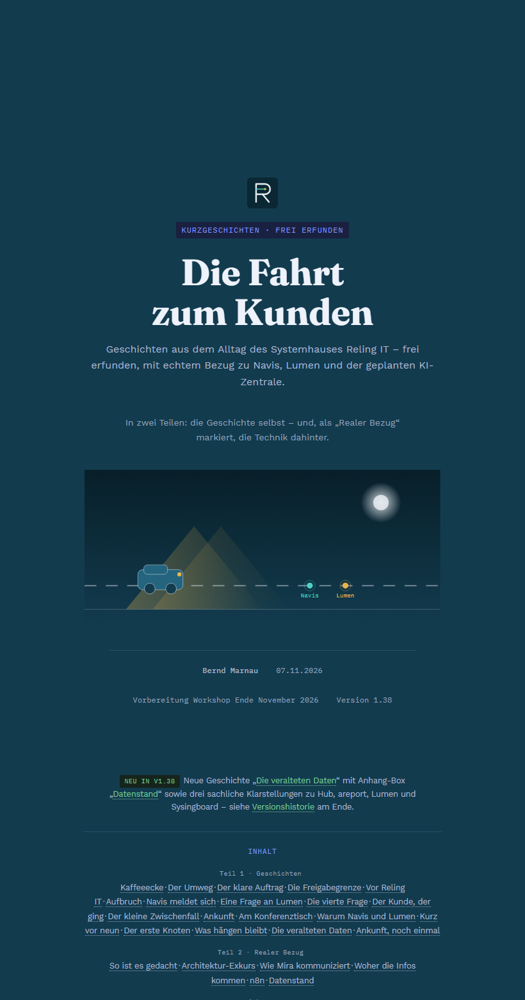 | 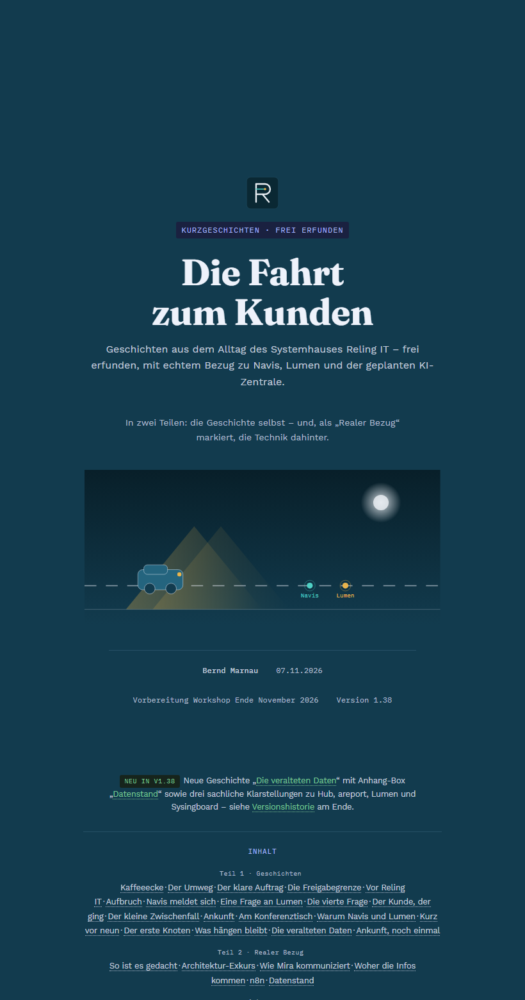 |
| Szene „Navis meldet sich“ (Fließtext, Navis-Box) | 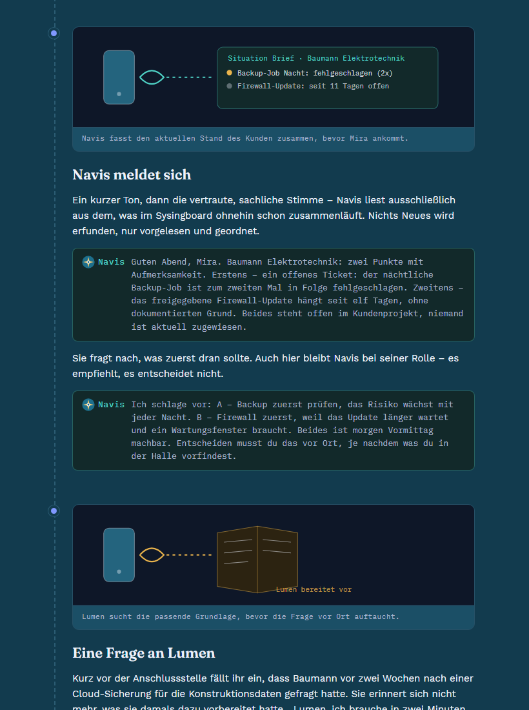 | 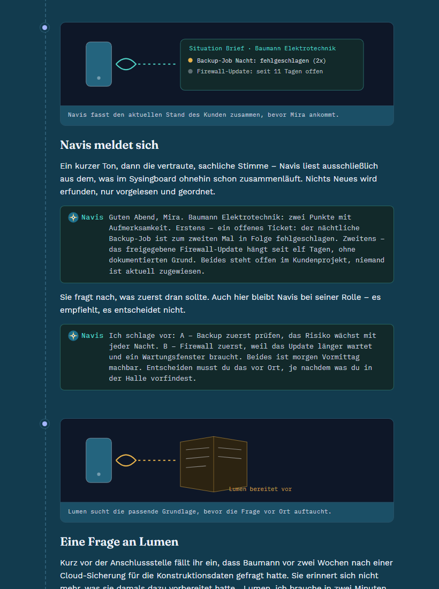 |
| Codebox „Noras eckige Klammern“ | 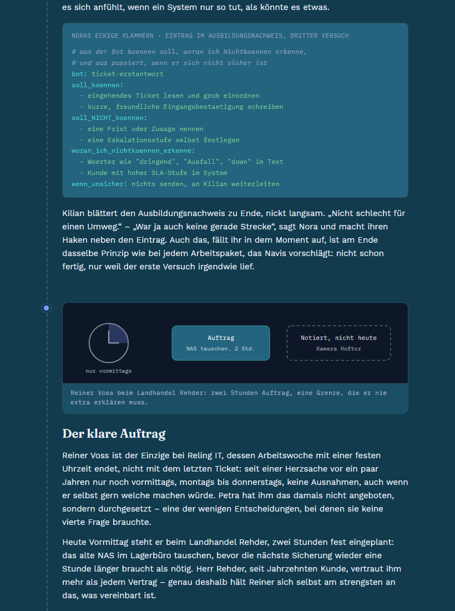 | 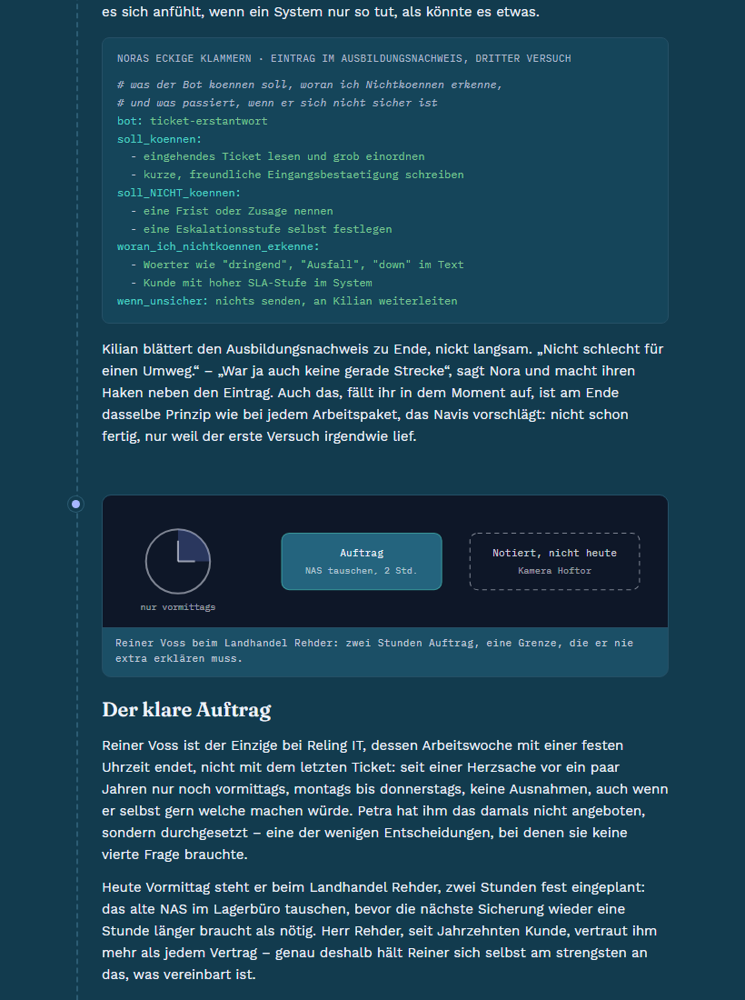 |
| SVG-Seite „So ist es tatsächlich gedacht“ (aside.real mit Grafik auf `--surface-2`) | 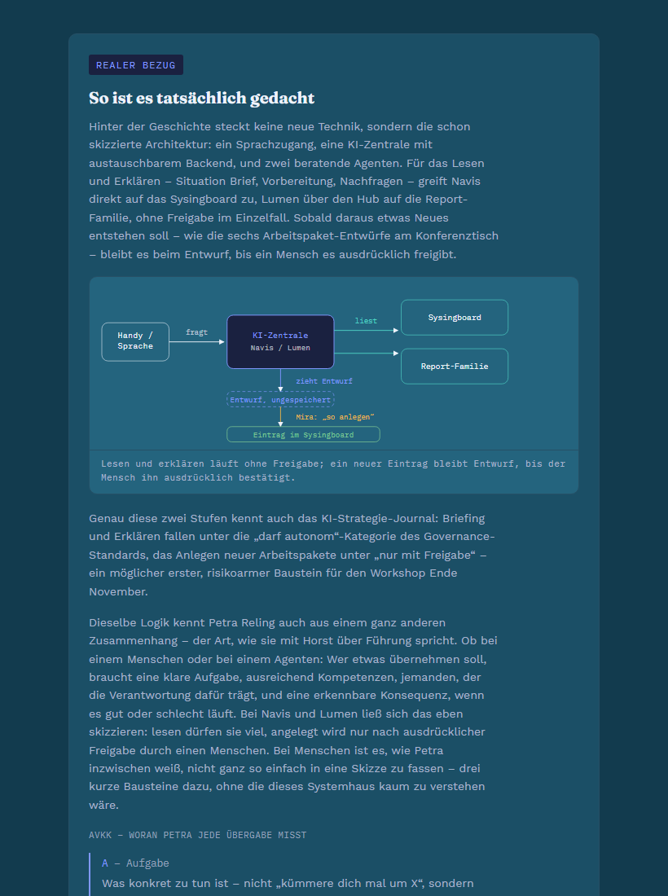 | 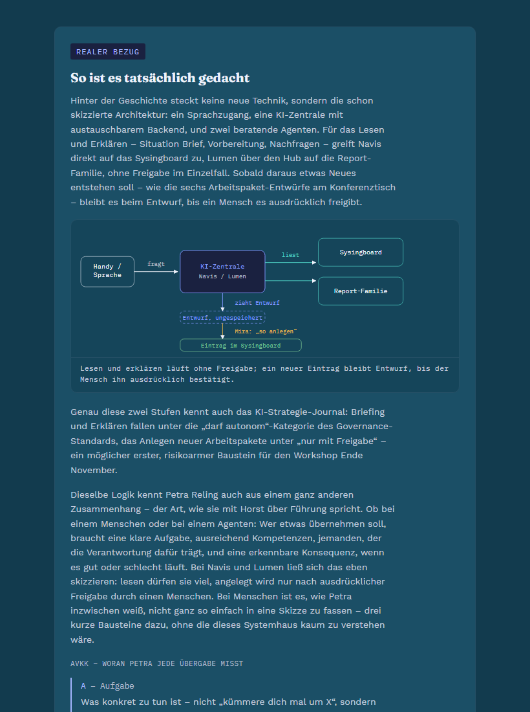 |
| Zusatz: Personenliste (`.badge`, `.role`, `.tenure`) | 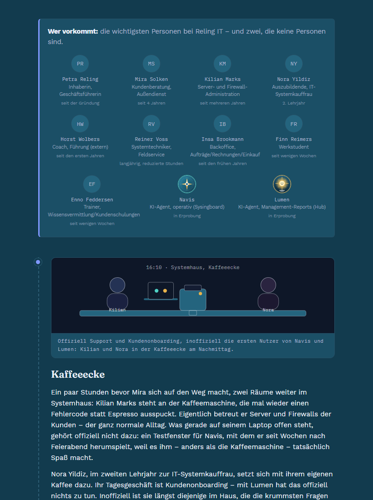 | 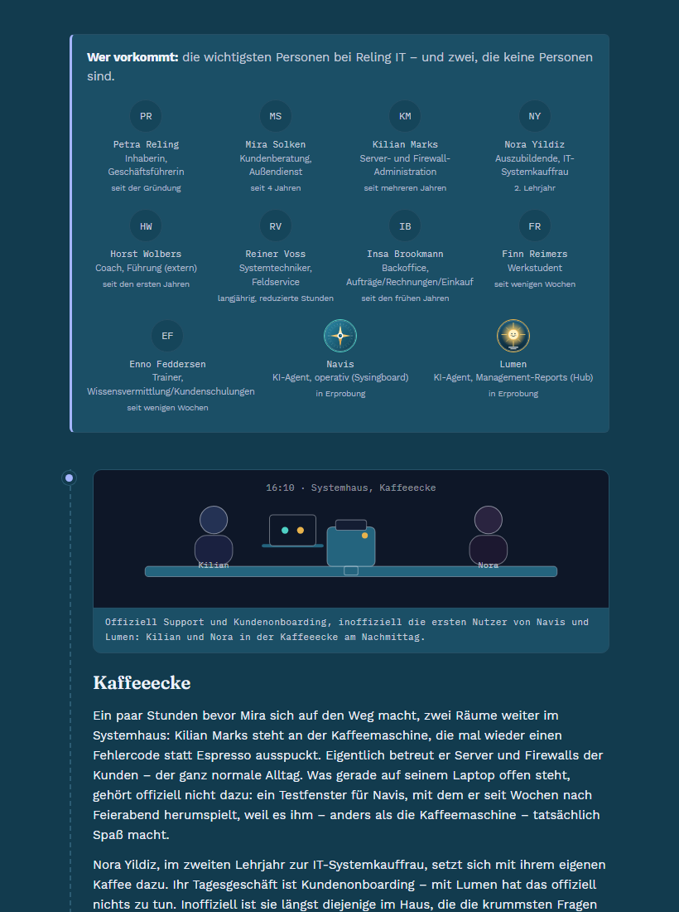 |
| Zusatz: Versionshistorie (`.vtable`) | 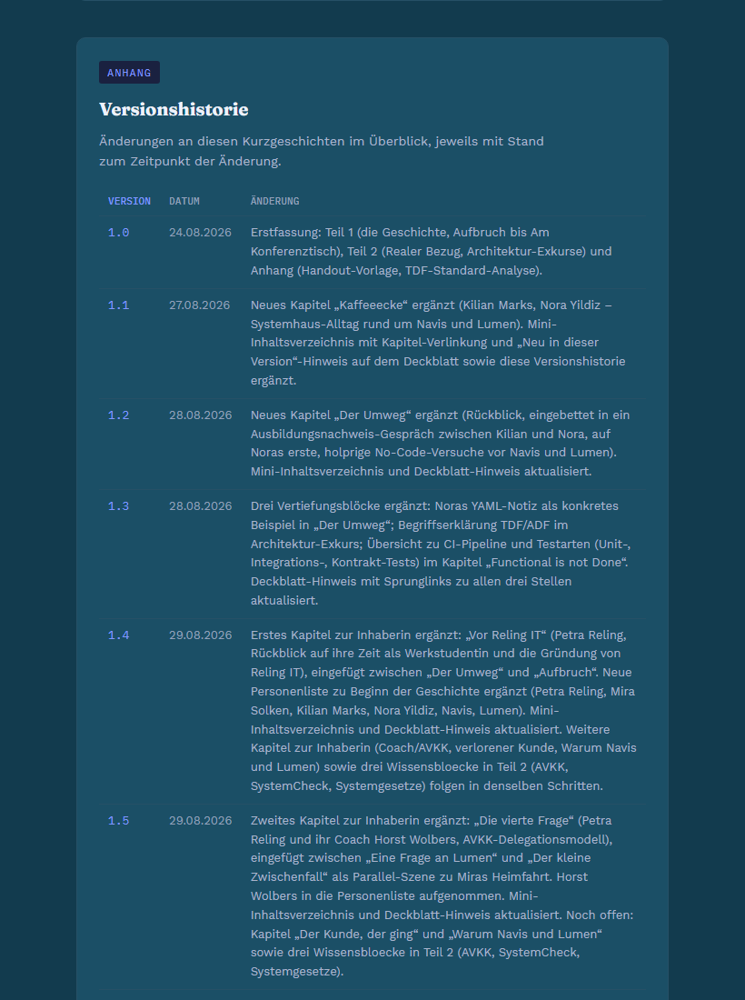 | 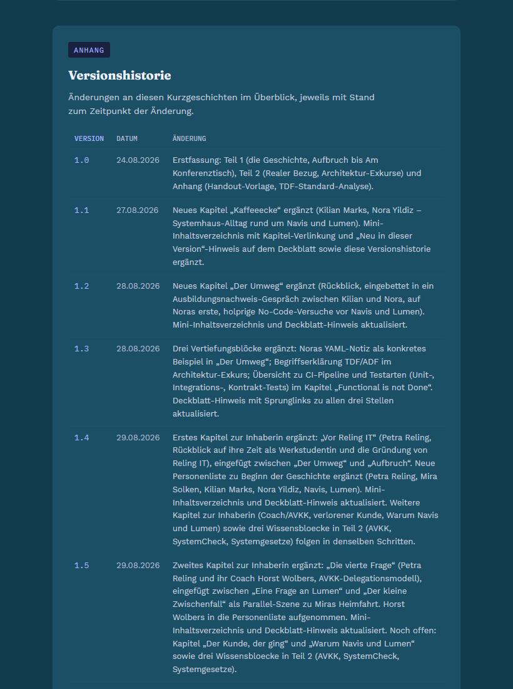 |

Sichtbar: Meta- und Nebentexte sind deutlich heller. Die Codebox ist dunkler und hat damit mehr Kontrast, wirkt aber weniger abgesetzt. Die Grafiken selbst (SVG-Inhalt) sind unverändert.

## Prüfungen mit Belegen

| Prüfung | Ergebnis |
|---|---|
| `scripts/ci-check.ps1` lokal (Worktree) | Exit 1, genau 1 Fehler: „Veröffentlichungsfassung ist nicht aktuell: story/current/fahrt-zum-kunden.html weicht von source/fahrt-zum-kunden.html ab“. Alle anderen Prüfungen bestanden (Vollständigkeit der Buchquelle, Links, IDs, Version/Datum). |
| CI des PR #33 („Website prüfen“, Lauf 42956682442) | fail nach 7 s, derselbe einzige Fehler (Log: „story/current/fahrt-zum-kunden.html weicht von …“, „CI-Prüfung mit 1 Fehler(n) abgebrochen“). |
| Pester `Invoke-Pester -Path tests` (Pester 3.4) | 21 bestanden, 0 fehlgeschlagen, 0 übersprungen. |
| `git diff --stat origin/main HEAD` | `source/fahrt-zum-kunden.html` 12 Zeilen (+7 −5), sonst nichts. |
| Signatur | `git log --show-signature`: gültige ED25519-Signatur. |
| `git merge-tree --write-tree origin/auftrag-R06-standards-box-v139 HEAD` (#27) | Exit 0, Baum 1a7ece6, keine Textkollision. #27 ändert keine Tokens, nutzt aber `--accent` und `--ink-faint` in neuen Regeln (`a.inref`, `.fn`) und profitiert damit automatisch. |
| `git merge-tree` gegen #26 (`auftrag-R07-anhang-seite`) und #25 (`auftrag-R11-avatare-webseite`) | jeweils ohne Konflikt (zusätzlich geprüft). |

**Warum die CI rot bleibt:** `ci-check.ps1` verlangt, dass `source/fahrt-zum-kunden.html` und `story/current/fahrt-zum-kunden.html` bytegleich sind. Für eine grüne CI müsste die Lesefassung nachgezogen werden, und dazu passend das PDF. Beides ist laut Auftrag ein eigener Schritt. Den kleinsten sauberen Weg bietet deshalb dieser Draft: nur `source/` ändern, mit einem einzigen und erklärten CI-Fehler. Ein Kopieren nach `story/current` ohne neues PDF hätte die CI grün gemacht, HTML und PDF auf `main` aber auseinanderlaufen lassen. Das wurde deshalb nicht gemacht.

## Abweichungen und Risiken

- **Versionsangaben nicht erhöht:** Deckblatt und Versionshistorie stehen weiter auf 1.38. Version 1.39, die Zeile in der Versionshistorie, `story/current` und das neue PDF kommen mit dem Release-Auftrag v1.39 bzw. zusammen mit #27.
- **Nachzug mit #27:** Beide PRs ändern dieselbe Buchquelle ohne Textkonflikt. #27 bringt aber eigene Fassungen von `story/current` und PDF mit. Wer zuletzt merget, muss Lesefassung und PDF aus der gemeinsamen Quelle neu erzeugen, sonst bleibt die CI rot bzw. das PDF zeigt die alten Farben.
- **PDF-Wirkung:** Die Farben wirken über `print-color-adjust:exact` auch auf das PDF. Die Seitenzahl ändert sich nicht, weil Farben das Layout nicht beeinflussen. Beim Release-Auftrag sollte das PDF trotzdem kurz visuell geprüft werden.
- **Knappe Werte:** `--ink-faint` und `--accent` auf `--surface` liegen bei 4,56 bzw. 4,55:1. Das ist bestanden, aber ohne Reserve. Diese Werte hatte R31 vorgeschlagen, sie wurden übernommen, damit der Farbton möglichst nah am Original bleibt.
- **Weniger Absetzung der Codebox:** Gegen die Seite liegt sie nur noch bei 1,15:1, erkennbar vor allem am Rahmen. Das ist kein AA-Kriterium, aber eine Geschmacksfrage für den Product Owner.
- **Nicht Teil von R41 (offen):** Zwei Inline-`opacity` im Markup unterschreiten weiter 4,5:1. Erstens „(früher ADF)“ in der Begriffsliste (`opacity:.6` auf `--accent`, vorher 2,13:1, nachher 2,65:1). Diese Zeile ändert auch #27, eine Änderung hier hätte einen Konflikt erzeugt. Zweitens `#render-stamp` (`opacity:.55`, vorher 2,41:1, nachher 2,93:1). Er ist auf dem Bildschirm leer und erscheint nur im PDF. Fest kodierte Farben in den SVG-Grafiken (u. a. `#8098ff`, `#24647e`) sind unverändert, weil sie R31 als „sollte“ führt.
- Gerendert wurde eine Kopie der Quelle mit einem eingefügten Verschiebe-Skript. Die Bilder zeigen also die Quelle, nicht die Website im iframe. Die Farben sind identisch.

## Vorschläge und Ideen (Claude)

- **Kontrastprüfung in `ci-check`:** Das Skript `kontrast_r41.py` als `tools/check_contrast.py` übernehmen. Es liest die Tokens aus dem `:root` der Buchquelle und rechnet die Paare als Datentabelle. Unter 4,5:1 bricht es ab. So bleibt der Stand von R41 auch bei künftigen Farbänderungen gesichert.
- **Inline-`opacity` verbieten:** Eine kleine CI-Regel könnte `style="…opacity…"` an Textelementen in der Buchquelle melden. Das trifft die beiden verbliebenen Restfälle und verhindert neue. Die Bereinigung sollte zusammen mit #27 erfolgen.
- **Reserve schaffen:** Beim v1.39-Release `--ink-faint` und `--accent` um einen Hauch aufhellen (z. B. `#b4bed0` / `#a9b9ff`, ca. 4,8:1). Dann kippt kein Wert bei leicht abweichendem PDF-Farbmanagement.
- **Codebox stärker absetzen ohne Kontrastverlust:** Statt einer helleren Fläche einen linken Akzentrand (`border-left:3px solid var(--navis)`) wie bei `.intro`. Die Codebox wäre dann klar abgegrenzt, die Werte blieben unverändert.
- **SVG-Farben an Tokens koppeln:** Die 46 fest kodierten `#8098ff` in den Grafiken als `currentColor` oder `var(--accent)` führen. Dann zieht eine Token-Änderung auch die Grafiken nach.

Hygiene: gemergte Remote-Branches außer main: keine. Offene PRs, alle als Draft: #33 (R41), #32 (R56), #31 (R54), #30 (R55), #28 (R49), #27 (R06), #26 (R07/R46), #25 (R11). Worktree C:/dev/wt-r41 bleibt für PR #33 stehen. Der Arbeitsklon ist unberührt.

```yaml
Reifegrad: Beta – Buchquelle erfüllt AA-Textkontraste der R31-Muss-Befunde; Lesefassung/PDF noch alt, zwei Inline-opacity-Restfälle
Projektstatus: v1.38 veröffentlicht bzw. im Upload; v1.39 in Draft-PRs (#27 Inhalt, #33 Kontraste) vorbereitet, gemeinsamer Nachzug von Lesefassung und PDF offen
Offene_Fragen:
  - Reihenfolge #27 und #33 – wer merget zuerst, wer erzeugt danach Lesefassung und PDF neu?
  - Ist die weniger abgesetzte Codebox gestalterisch in Ordnung, oder soll ein Akzentrand ergänzt werden?
  - Sollen die Inline-opacity-Restfälle („früher ADF“, render-stamp) mit #27 bereinigt werden?
  - Kontrastprüfung dauerhaft in ci-check aufnehmen?
Roadmap:
  Sprints_bis_BSF: 1
  Sprints_bis_MVP: 2
  Hinweis: unbelegte Schaetzung
```
